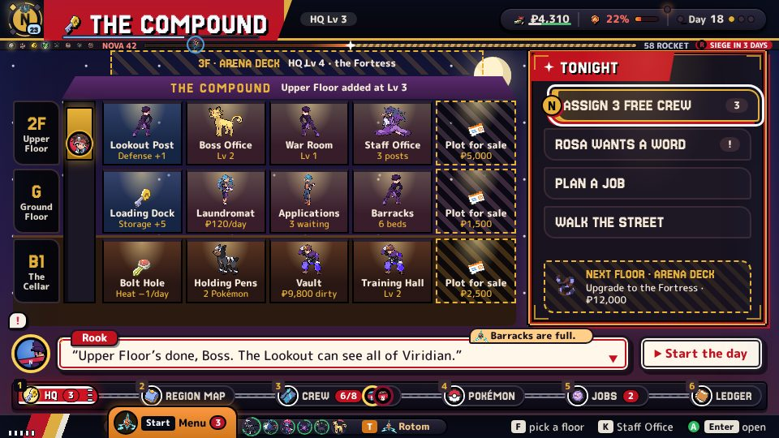
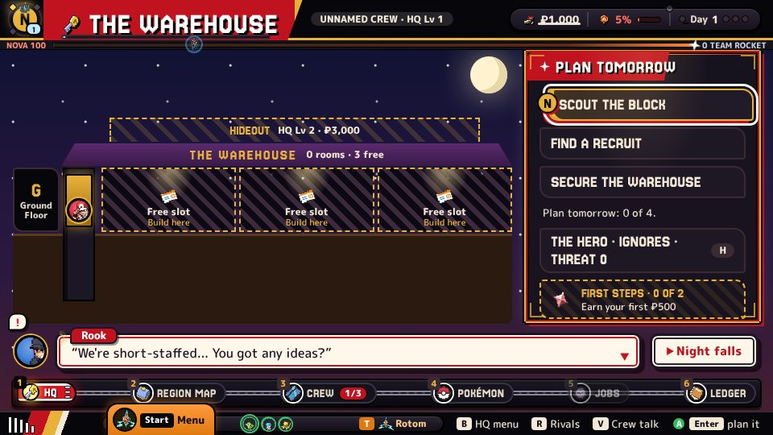
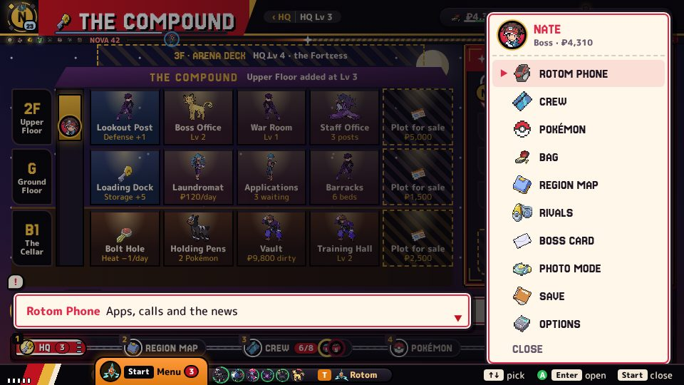
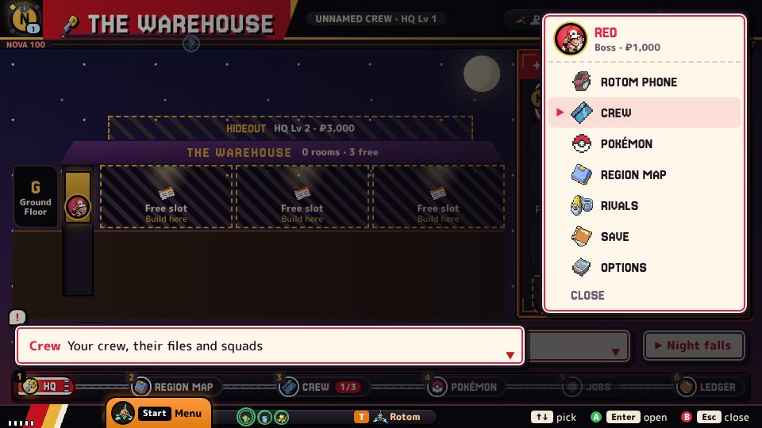
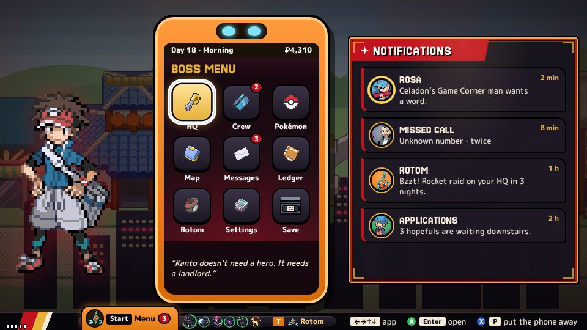
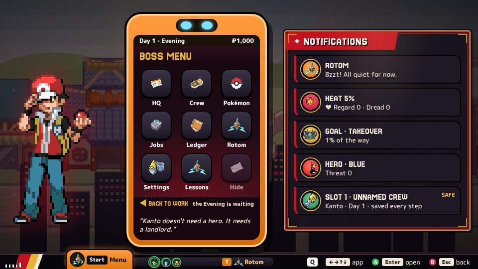

# Dominion redesign R0: the pass-50 foundation, HQ, Start menu and Boss Menu

Kice, 2026-11-21 12:25 PM PT: "BUILD EVERYTHING AS CLOSE TO THE MOCKUPS AS YOU CAN. Keep redoing and remaking things until they look exactly like the mockups." Target: pass 50 ("Final Cut") of `plans/evil-mode-rework/redesign-50/`. Build plan and slices R1-R9: `/mnt/project-files/plans/dominion-redesign-build/BUILD_SLICES.md`.

## What R0 built

- **The styles, ported, not redrawn.** `tools/dominion/port-r50.py` turns the mockups' CSS for passes 1-50 into `src/ui/redux/screens/dominion/r50/r50.css` (332 KB, 243 keyframes): scoped under `#rx #r5` (the page root's id), every element reset to browser defaults first (the game's `.rx .keys`, `.rx .row`, `.rx .tabs` share names with the mockups), keyframes prefixed `r5-`, and every animation offset by the page clock `--now` so a redraw (a cursor move) doesn't replay entrances. It also writes `r50/sizes.ts` (pixel size of every sprite). Never edit r50.css by hand: fix the mockup or the tool and run `python3 tools/dominion/port-r50.py`. Game-only extras live in `r50/game.css`.
- **The sprites:** the mockups' 357 PNGs in `public/assets/images/dominion/r50/` (provenance in `PROVENANCE.md`).
- **The shared chrome** `r50/kit.ts`: page root and clock, every background layer, the top bar (crest, title plate, funds/heat/day capsule), the war strip or news ticker, the place sign, the text box with Rotom's tip, the six rail tabs and the key strip with the party and the Rotom chip. Live data comes from `r50/run.ts` (`r5RunOf`, display only).
- **The HQ hub** (mockup `hq`): the building cross-section from the real rooms (floors from the room grid, the lift with the Boss, empty slots as plots), the side panel (Today's orders / Plan tomorrow / Night report / Tonight, applications desk, the Hero, First steps or the next HQ level), the member on duty in the text box, the clock button. Threat from the rival team is Rotom's tip (tap: Rival File).
- **The Start menu** (mockup `start`): tap the Start chip on the HQ. Rotom Phone (Boss Menu), Crew, Pokémon, Region map, Rivals, Save, Options, Close.
- **The Boss Menu as Rotom's phone** (mockup `menu`, Esc on the HQ): nine apps in a 3x3 grid plus a Back to work bar (arrows move on the grid), the Notifications panel (Rotom's alert, Heat, the Goal, the Hero, the save slot), the Boss beside the phone.
- Every `data-testid` the old HQ and Boss Menu had is kept (phase, funds, heat, roster and band are screen-reader text where the mockup has no visible label).

## Mockup vs game (960x540)

| Page | Mockup | Game |
|---|---|---|
| HQ |  |  |
| Start |  |  |
| Boss Menu |  |  |

Differences left on purpose (live data, not looks): a new run's HQ has one floor and empty slots; the Boss is the run's trainer; numbers are the run's.

## Needs a mechanic (not built, no placeholder)

- Start menu: **Bag**, **Boss card**, **Photo mode** (R4 / R9 slices).
- Phone apps **Map**, **Messages**, **Save** (the game saves every step; Map is tab 2).
- Top bar: the Boss's own level and EXP (the crest shows the HQ level), gyms row, festivals, crew who want a word (wf28).
- Chrome links to pages a later slice builds (`r5go` ids such as glance, clock, jukebox, party, ask) do nothing yet.

## Tests

- `tests/unit/dominionR50.test.ts` (7): the chrome reads the run without changing it; hub, Start and phone keep the old test ids; the phone cursor's grid and boundaries.
- `tests/e2e/dominionR50.spec.ts`: HQ, Start (arrows, Esc) and the phone; the run block is unchanged; no console errors. Shots in its output folder.
- `tests/e2e/dominionStart.spec.ts`: the member card's text now reads Rook in the text box (the redesign has no member card).

No save change.
