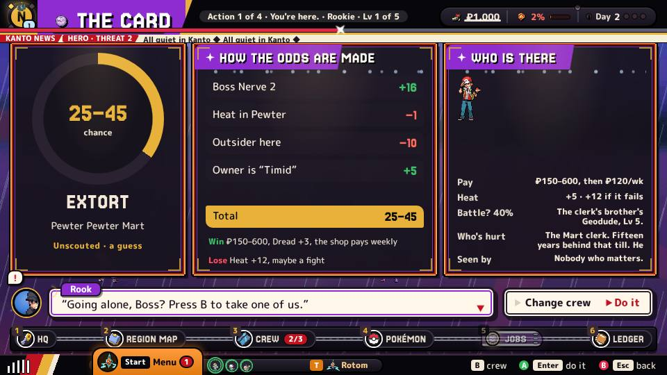
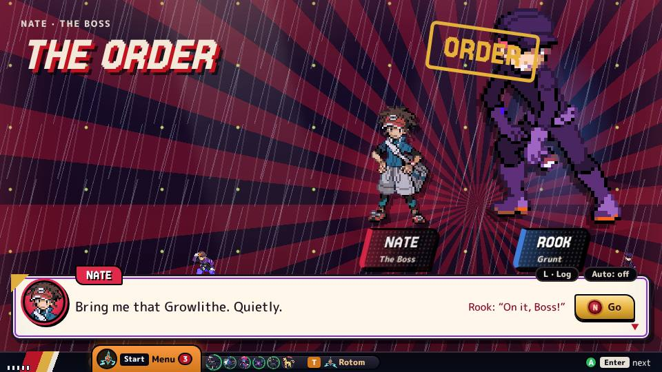
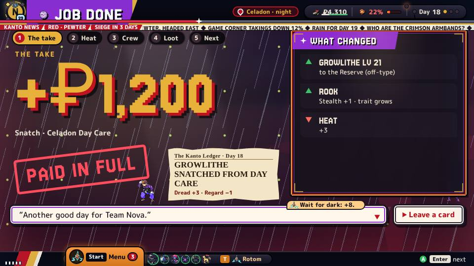
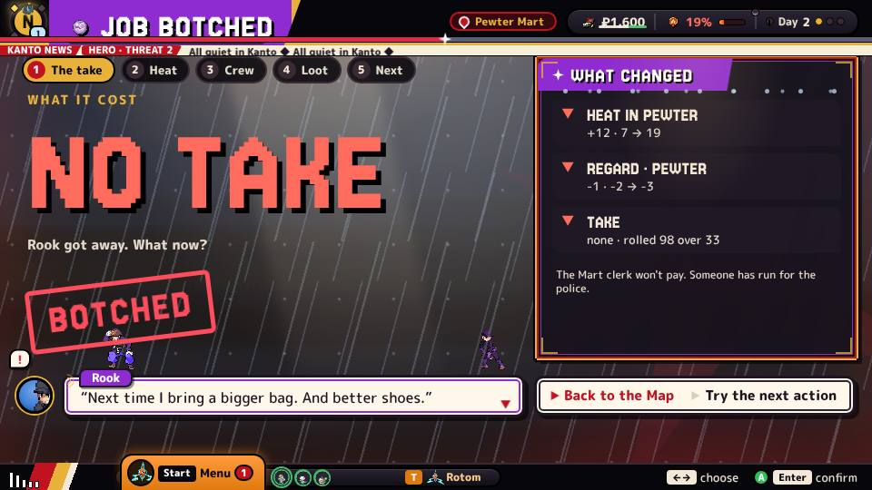

# Dominion redesign R4: Jobs, Trainers and Gimmicks

Kice, 2026-11-21 12:25 PM PT: "BUILD EVERYTHING AS CLOSE TO THE MOCKUPS AS YOU CAN." Target: pass 50 of `plans/evil-mode-rework/redesign-50/`, slice R4 of `/mnt/project-files/plans/dominion-redesign-build/BUILD_SLICES.md`. Built on the R0 kit (`src/ui/redux/screens/dominion/r50/kit.ts`).

## What R4 built

| Mockup | What the game now shows | Where |
|---|---|---|
| `card` | The Card: the chance ring (a range or "?" is written in it), how the odds are made with the total, what a win and a loss mean, who is there (the member going or the Boss, the foe's Pokémon) with Pay, Heat, Battle, who's hurt and who might see. A crew member talks in the text box; a Card that says no puts the reason there and dims Do it. The Card's choices (a Gym way, a bribe) and their note sit above the odds. | `r50/jobs.ts` `r5Card`, scene `cardPage` |
| `crewpick` | **New page.** B (or Change crew) on the Card: every member with their skill for this job and what they add to the odds (worked out by the Card, never rolled), Enter picks or drops, a solo job swaps, a squad job stops at its limit. Esc goes back to the Card. Only the Card's cursor changes. | `r5CrewPick`, `CrewPick` |
| `order` | The Boss order cut-in: the Boss and the member who goes, the order stamped, both lines. Same timing and skip as D30. | `r5Order`, `jobController.ts` |
| `done` | Job done: the take counting up, the stamp, the roll, every change (with where it came from), the weekly pay, the act's own lines as the Kanto Ledger clipping. To the Map / Next action. | `r5Done` |
| `botched` | Job botched: CAUGHT or NO TAKE, what it cost, the choices in the text box (To the Map / Next action; Face the police; Bail / Break out / Leave for a held member, with the chosen one's cost as the line). | `r5Botched` |
| `herohit` | The Hero shows up: the member against the Hero, VS, three answers (Battle, Run, Smoke Ball; dimmed without one). | `r5HeroHit` |
| `lessonjob` | The tutorial's Card lesson as Rotom's coach over the page (dim, dashed ring on the odds, Skip lesson / Next). Drawn inside the page so it wears the pass-50 styles. | `r5CardLesson`, `tutorial.ts` case `card` |
| `tcard` | **New page.** The Boss card from the Start menu: name, HQ level, money, crew, Heat, day, the Goal bar, the eight Gym marks (yours lit); the back: skills, best job, the Hero, Gyms held. Display only. | `r50/trainers.ts`, scene `bossCardPage` |

Every `data-testid` the old views had is kept (`dom-card*`, `dom-doit`, `dom-bring`, `dom-order*`, `dom-job-*`, `dom-interrupt*`, `dom-tut-tip`). The old view functions stay in `fieldViews.ts`, `moments.ts` and `heroViews.ts` (their unit tests still run) but the scene no longer draws them.

## Mockup vs game (960x540)

| Page | Mockup | Game |
|---|---|---|
| The Card |  |  |
| Pick the crew |  |  |
| The order |  |  |
| Job done |  |  |
| Job botched |  |  |
| The Hero shows up |  |  |
| Boss card |  |  |

Differences left on purpose (live data, not looks): the Boss is the run's trainer; a new run has one or two members and Day 2 numbers; the order shot is taken mid-typing. The music chip ("Night job") and the main game's Professor hint are transient overlays from outside these pages.

## Kept as the main battle UI (rule 5)

`battle`, `fight`, `vs`, `ace`, `mega`, `dyna`, `tera`, `zmove`: a Dominion fight runs in the main BattleScene, which already has its own VS intro (`ui/battleFx/vsScreens.ts`), ace announcement and Mega / Dynamax / Tera / Z scenes (`ui/battleFx/*Scene.ts`). The build plan keeps the main battle UI; no move animation was touched.

## Needs a mechanic (not built, no placeholder)

- `jobs` (Job board, three jobs side by side): the game's job board is the Region Map's action grid and the District file (R3's pages); there is no separate board.
- `live` (Case it / Slip in / Grab / Get out with a "something happens" choice): a job is one roll in `field.ts act()`; the only mid-job choice is the Hero (`herohit`).
- `calling` (leave a Calling card after a job): no such rule.
- `market` (Black Market shop): the Fence action and Black Market contact exist, but no shop or buy rule (`core/grandArc/doom.ts` notes it isn't built).
- `cargo` (Smuggling run, load the bus): Smuggle routes pay nightly (`growth.ts`), but there is no cargo or ticket-check choice.
- `gymplan` (weak spots and a path in): a Gym's five ways are the Card's choices (shown on the Card); there is no weak-spot plan.
- `gymtalk` (the Leader's choice: step aside / pay / battle): not a rule.
- `crewin`, `teamup`, `phase`, `snap`, the Hideout raid's "turns to hold": the crew add odds, they don't fight turns; no team-up, no boss phase two in Dominion fights, no battle album.
- `legend` (Archer betrays Giovanni, then Mewtwo): the Legendary fight exists from the Hero file (R7's page); the betrayal scene isn't a rule.
- `power`, `gear` (Pick a power, Power gear unlocked per region): the main battle's gimmicks use Bag items; Dominion has no power-gear unlock rule.

## Tests

- `tests/unit/dominionR4.test.ts` (12): the Card's test ids, plain pay text, range and hidden odds, blocked Card, choices; the lesson coach inside the page; Pick the crew picks (solo swap, squad limit refused, drop) and cursor edges; order, done, botched (2 / 1 / 3 choices, dimmed bail), the Hero (cursor, no Smoke Ball), the Boss card.
- `tests/e2e/dominionR4.spec.ts`: Card, Pick the crew (the run block unchanged, the odds change), order, done, botched, the Hero, the Boss card from the Start menu (block unchanged); no console errors; shots in its output folder.
- Passed locally: dominionR4, dominionMoments, dominionHero, dominionMap, dominionR50, dominionGrowth, dominionPages, dominionTutorial, dominionStart (17 tests).

No save change.
