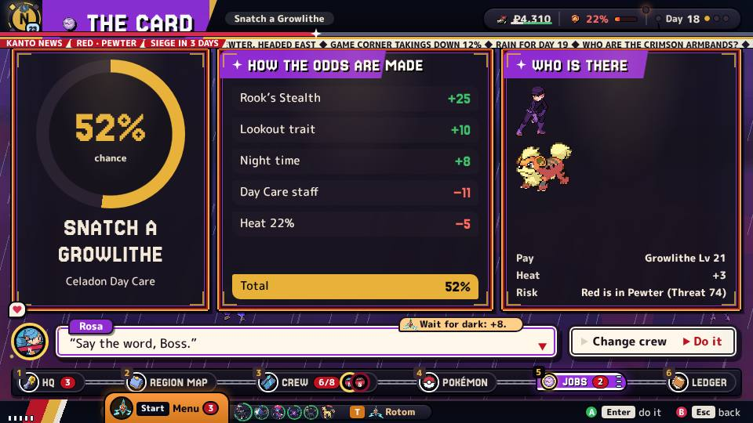
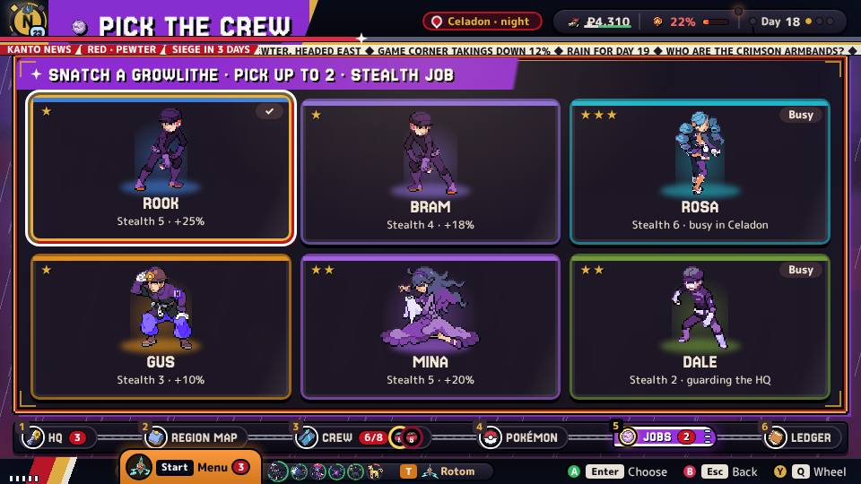
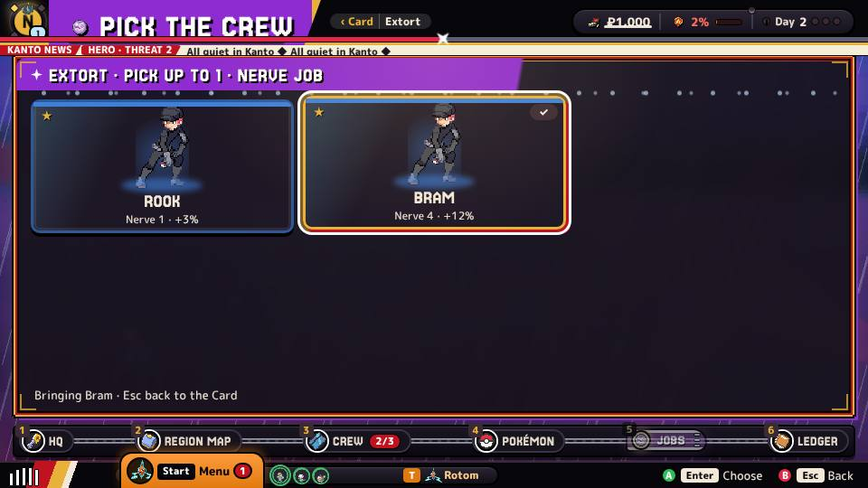
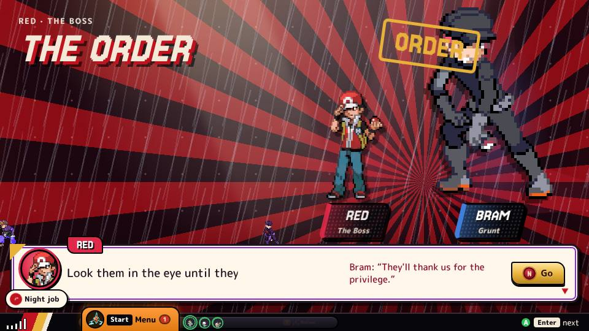
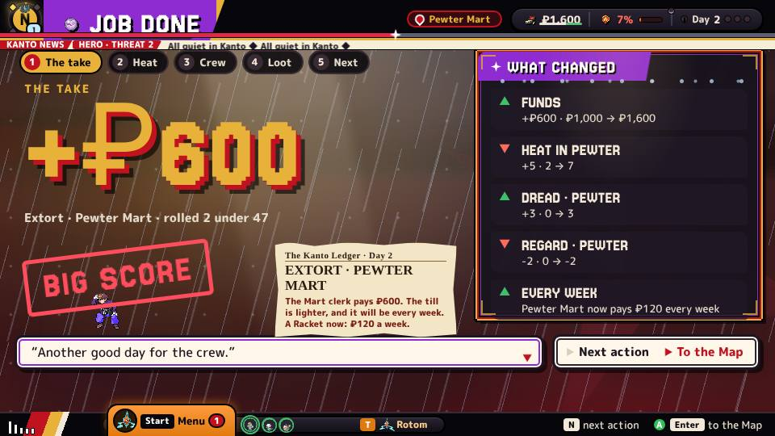
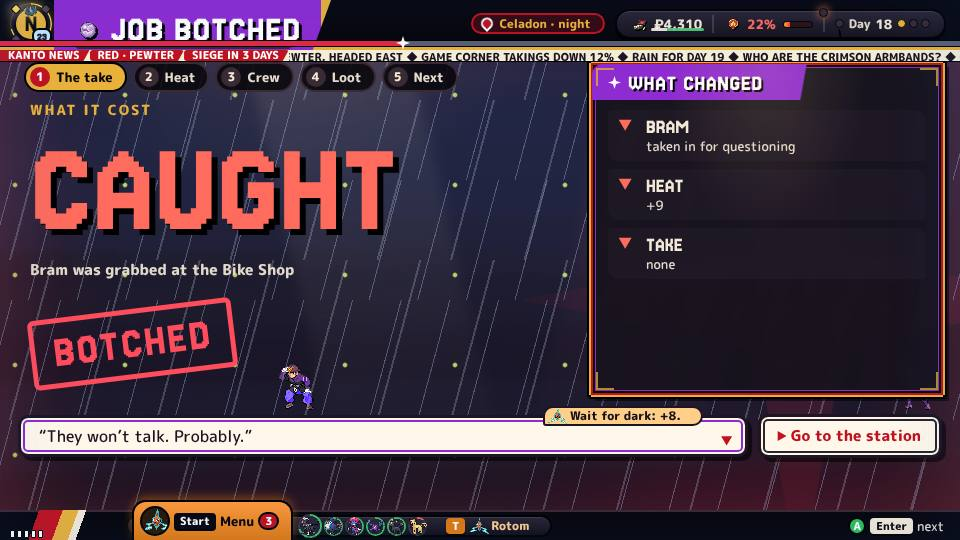
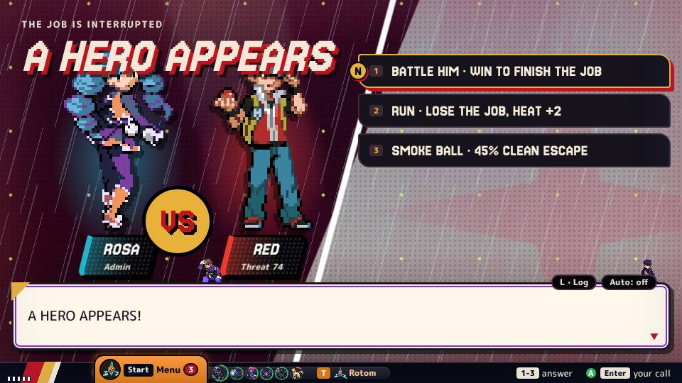
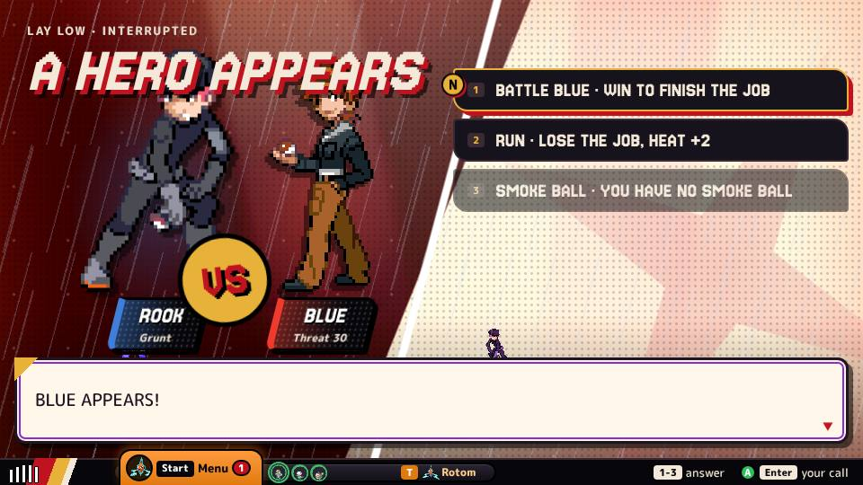
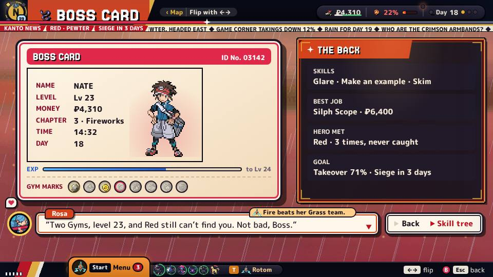
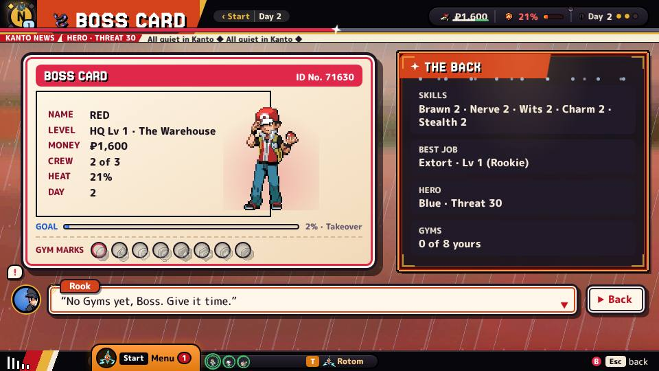

# Dominion redesign R4: Jobs, Trainers and Gimmicks

Kice, 2026-11-21 12:25 PM PT: "BUILD EVERYTHING AS CLOSE TO THE MOCKUPS AS YOU CAN." Target: pass 50 of `plans/evil-mode-rework/redesign-50/`, slice R4 of `/mnt/project-files/plans/dominion-redesign-build/BUILD_SLICES.md`. Built on the R0 kit (`src/ui/redux/screens/dominion/r50/kit.ts`).

## What R4 built

| Mockup | What the game now shows | Where |
|---|---|---|
| `card` | The Card: the chance ring (a range or "?" is written in it), how the odds are made with the total, what a win and a loss mean, who is there (the member going or the Boss, the foe's Pokémon) with Pay, Heat, Battle, who's hurt and who might see. A crew member talks in the text box; a Card that says no puts the reason there and dims Do it. The Card's choices (a Gym way, a bribe) and their note sit above the odds. | `r50/jobs.ts` `r5Card`, scene `cardPage` |
| `crewpick` | **New page.** B (or Change crew) on the Card: every member with their skill for this job and what they add to the odds (worked out by the Card, never rolled), Enter picks or drops, a solo job swaps, a squad job stops at its limit. Esc goes back to the Card. Only the Card's cursor changes. | `r5CrewPick`, `CrewPick` |
| `order` | The Boss order cut-in: the Boss and the member who goes, the order stamped, both lines. Same timing and skip as D30. | `r5Order`, `jobController.ts` |
| `done` | Job done: the take counting up, the stamp, the roll, every change (with where it came from), the weekly pay, the act's own lines as the Kanto Ledger clipping. To the Map / Next action. | `r5Done` |
| `botched` | Job botched: CAUGHT or NO TAKE, what it cost, the choices in the text box (To the Map / Next action; Face the police; Bail / Break out / Leave for a held member, with the chosen one's cost as the line). | `r5Botched` |
| `herohit` | The Hero shows up: the member against the Hero, VS, three answers (Battle, Run, Smoke Ball; dimmed without one). | `r5HeroHit` |
| `lessonjob` | The tutorial's Card lesson as Rotom's coach over the page (dim, dashed ring on the odds, Skip lesson / Next). Drawn inside the page so it wears the pass-50 styles. | `r5CardLesson`, `tutorial.ts` case `card` |
| `tcard` | **New page.** The Boss card from the Start menu: name, HQ level, money, crew, Heat, day, the Goal bar, the eight Gym marks (yours lit); the back: skills, best job, the Hero, Gyms held. Display only. | `r50/trainers.ts`, scene `bossCardPage` |

Every `data-testid` the old views had is kept (`dom-card*`, `dom-doit`, `dom-bring`, `dom-order*`, `dom-job-*`, `dom-interrupt*`, `dom-tut-tip`). The old view functions stay in `fieldViews.ts`, `moments.ts` and `heroViews.ts` (their unit tests still run) but the scene no longer draws them.

## Mockup vs game (960x540)

| Page | Mockup | Game |
|---|---|---|
| The Card |  |  |
| Pick the crew |  |  |
| The order |  |  |
| Job done |  |  |
| Job botched |  |  |
| The Hero shows up |  |  |
| Boss card |  |  |

Differences left on purpose (live data, not looks): the Boss is the run's trainer; a new run has one or two members and Day 2 numbers; the order shot is taken mid-typing. The music chip ("Night job") and the main game's Professor hint are transient overlays from outside these pages.

## Kept as the main battle UI (rule 5)

`battle`, `fight`, `vs`, `ace`, `mega`, `dyna`, `tera`, `zmove`: a Dominion fight runs in the main BattleScene, which already has its own VS intro (`ui/battleFx/vsScreens.ts`), ace announcement and Mega / Dynamax / Tera / Z scenes (`ui/battleFx/*Scene.ts`). The build plan keeps the main battle UI; no move animation was touched.

## Pages that got simple new rules (Director 2026-11-21: "don't leave the 'needs a mechanic' pages out")

Rules and numbers live in `src/data/dominion/jobs.json` (`core/dominion/jobs.ts`) and `src/data/dominion/fights.json` (`core/dominion/bossFights.ts`). New block fields are optional (no save bump); no new random stream (live jobs and the market's stock use pure hashes of the seed).

| Mockup | Rule | Where |
|---|---|---|
| `jobs` | The Job board (Jobs tab): the best three jobs you can do now, within one trip; Enter opens that job's Card. | `jobBoard`, `r5JobBoard` |
| `live` | A stealth job may have "something happens" (35%): Stay still (odds down a little), Smoke Ball (clean escape, no take, uses the ball), Grab it and run (odds down more, Heat). | `liveOf`, `setLiveHook`, `r5Live` |
| `calling` | C on Job done: leave a calling card once per job. Dread up, Regard down, Heat and rival Tension up. | `leaveCard`, `r5Calling` |
| `market` | M on the board after dark with a Fence or Black Market contact: six items a day (from nine), bought with money into the Bag. | `marketStock`, `buy`, `r5Market` |
| `cargo` | The Smuggle Card is the Smuggling run: load crates (each adds pay and risk; risk lowers the odds). | Card hook, `r5Cargo` |
| `gymplan`, `gymtalk` | The Gym takeover Card is the Gym plan (the five ways as weak spots); Walk in shows the Leader's answer and your choices (Walk away changes nothing). | `r5GymPlan`, `r5GymTalk` |
| `gear`, `power` | Power gear (Start menu): one power opens after Day 5 of the first region, one more each region (the main game's boss rule). Pick a power puts that gear's key item (Mega Ring, Tera Orb, Dynamax Band, Z-Ring) in the Bag, so the main battle offers it; a swap takes back only gear Dominion gave. Gym Leaders and Bosses who face you get their powers by the same rule. | `powerSlots`, `carry`, `setUpFight`, `r5Gear`, `r5Power` |
| `crewin` | Before a fight at the HQ (a raid, the Hero's raid, a rival Boss at the door): pick a member to step in first. Their Pokémon loses 40% HP; the foe's lead starts up to 30% down. Esc: nobody. Once a fight. | `assistKind`, `assist`, `r5CrewIn` |
| `teamup` | Before a big fight away (rival, Hero, takeover, Gym chain, realm, final stand) and before phase two: up to three free members hit first, 12% each (36% max) off the foe's lead. Once a fight. | `assist`, `r5TeamUp` |
| `phase` | A rival Boss beaten at your door rallies once: the same fight waits again, the lead with Attack +1, your team not healed. Only the second win settles the raid. | `phaseTwo`, `r5Phase` |
| `legend` | When that Boss falls for good, their admin turns (Rocket: Archer) and the team's Legendary waits (Mewtwo, Lv 70 at most, your best level + 5). A wild battle: it can be caught. Once a team. | Fight hook, `foe: 'betrayal'`, `r5Legend` |
| `snap` | After a big win (Hero, Legendary, Gym, rival, takeover, realm, Betrayal) the Snapshot offers the moment: Save to album (40 at most) or Skip. The Boss card shows the album count. | Fight hook, `keepSnap`, `r5Snap` |

The main battle screen is unchanged (rule 5): these pages come before or after a battle.

## Tests

- `tests/unit/dominionJobs.test.ts` (14) and `tests/unit/dominionFights.test.ts` (11): the new rules (normal, boundary, refused) and the pages' test ids.
- `tests/e2e/dominionJobs.spec.ts`, `tests/e2e/dominionFights.spec.ts`: every new page by keys, with shots.

- `tests/unit/dominionR4.test.ts` (12): the Card's test ids, plain pay text, range and hidden odds, blocked Card, choices; the lesson coach inside the page; Pick the crew picks (solo swap, squad limit refused, drop) and cursor edges; order, done, botched (2 / 1 / 3 choices, dimmed bail), the Hero (cursor, no Smoke Ball), the Boss card.
- `tests/e2e/dominionR4.spec.ts`: Card, Pick the crew (the run block unchanged, the odds change), order, done, botched, the Hero, the Boss card from the Start menu (block unchanged); no console errors; shots in its output folder.
- Passed locally: dominionR4, dominionMoments, dominionHero, dominionMap, dominionR50, dominionGrowth, dominionPages, dominionTutorial, dominionStart (17 tests).

No save change.
