# Dominion redesign R5: the Crew pages (pass 50)

Kice, 2026-11-21: "BUILD EVERYTHING AS CLOSE TO THE MOCKUPS AS YOU CAN. Keep redoing and remaking things until they look exactly like the mockups." Slice R5 of `/mnt/project-files/plans/dominion-redesign-build/BUILD_SLICES.md`, built on the R0 kit (`docs/status/dominion-r0.md`).

## What R5 built

All pages are in `src/ui/redux/screens/dominion/r50/crew.ts` (markup from the pass-50 mockups) with display models in `src/core/dominion/crewR50.ts` (read the block, never change it, no RNG). The controllers keep the cursors; every change is still a `DominionAction` step.

| Page | How to get there | What it shows |
|---|---|---|
| Roster (`roster`) | tab 3 | The crew as cards (armband sprites), the picked member's stats, trait, Loyalty/Morale; Train, People, ID card, Full file |
| Crew File (`file`) | Enter or 3 again on the roster | The old Crew File's rules and test ids in the pass-50 file layout |
| Personality card (`person`) | C on the file | D19's card: memory, traits, home, Rotom's read |
| Crew ID (`idcard`) | V | The ID card with the team armband |
| Loyalty (`loyalty`) | Y | Everyone by Loyalty; who is close to walking |
| Payday (`payday`) | K | This week's wages and who is owed |
| Uniforms (`uniform`) | J | Team colours and armbands on everyone |
| Rank Pyramid (`pyramid`) | P | The ranks held, open seats, Enter promotes |
| Promotion night (`promo`) | a promotion | The scene after a promotion |
| Boss Edge (`levelup`) | E on the Pyramid, a tap on the Boss, or the emblem's level badge | The Boss's five Edge stats and XP to the next point (the game has no Boss level; Edge is what grows) |
| Squads (`squads`) | U | The squad cards (the builder and order picker keep the D8 look) |
| Confront (`interro`, `spy`) | F on a suspect's file | D22's room as a talk scene: questions, Accuse, Drop it, your own line |
| Mole hunt (`mole`) | M | The clue wall: up to three most suspected, their latest clue; Question opens Confront |
| Training (`school`) | Train on the roster | The Training and Growth tasks with odds; Send gives the order (Morning only) |
| New card (`pull`) | a hire or an admitted lead | The new member's card, beds, best stat, wage |
| People you know (`people`) | People on the roster | The crew, the rival teams in play, the Hero (once there is one), the law |
| Heart-to-heart (`heart`) | a crew talk card on the Crew tab | The talk card as a talk scene (the Morning keeps its own card until its slice) |

Every old `data-testid` is kept (some as screen-reader text where the mockup has no visible label).

## Mockup vs game (960x540)

| Page | Mockup | Game |
|---|---|---|
| Roster | 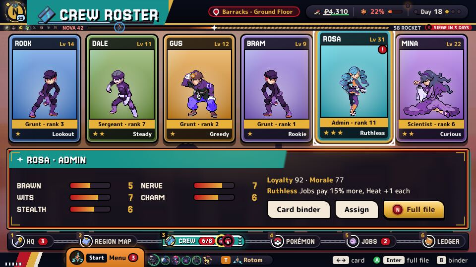 |  |
| Crew File | 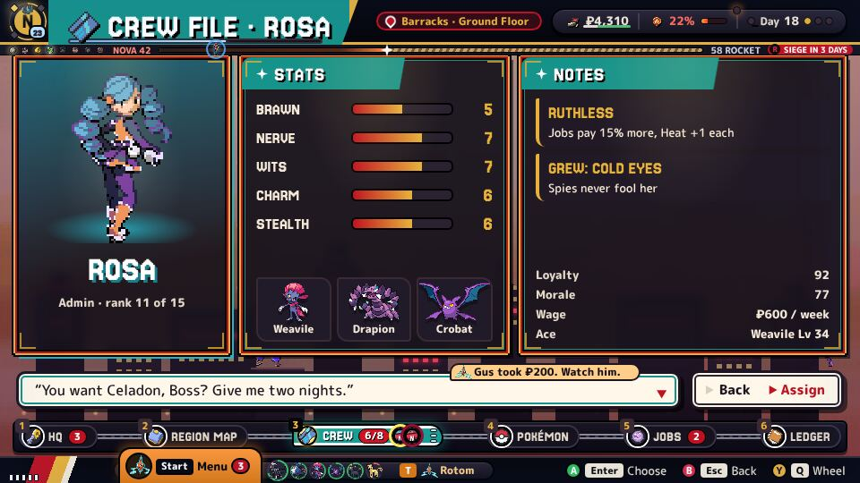 |  |
| Personality | 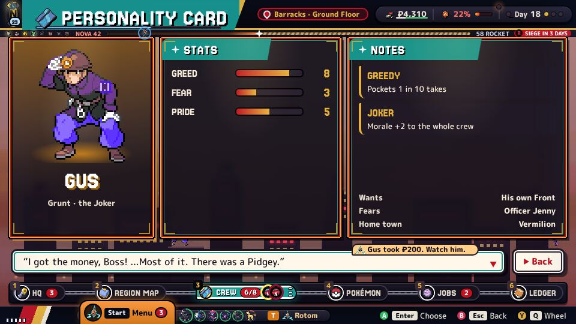 |  |
| Crew ID | 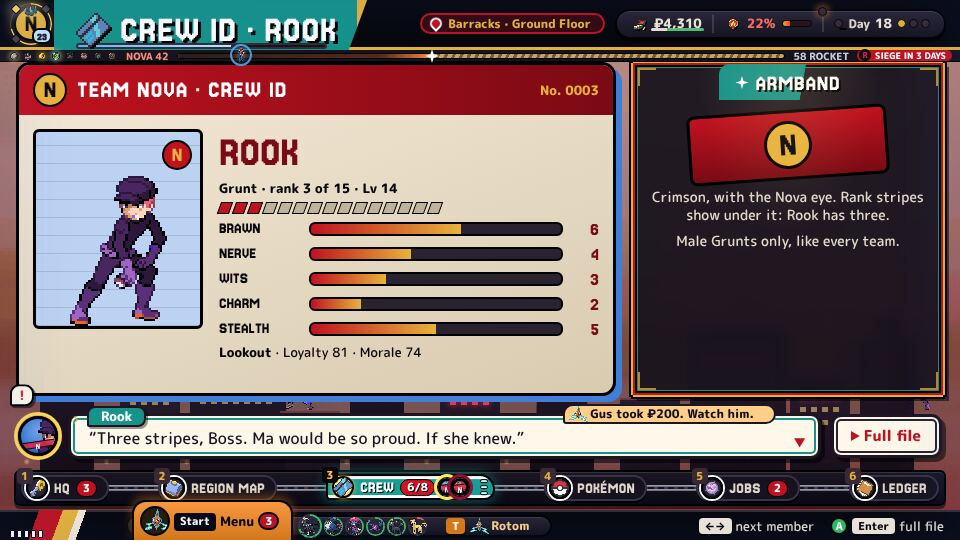 |  |
| Loyalty | 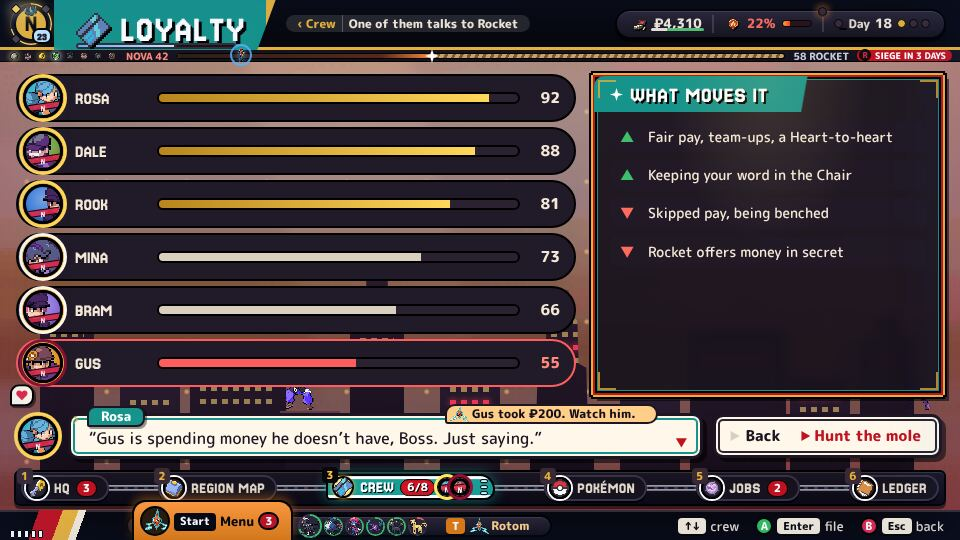 |  |
| Payday | 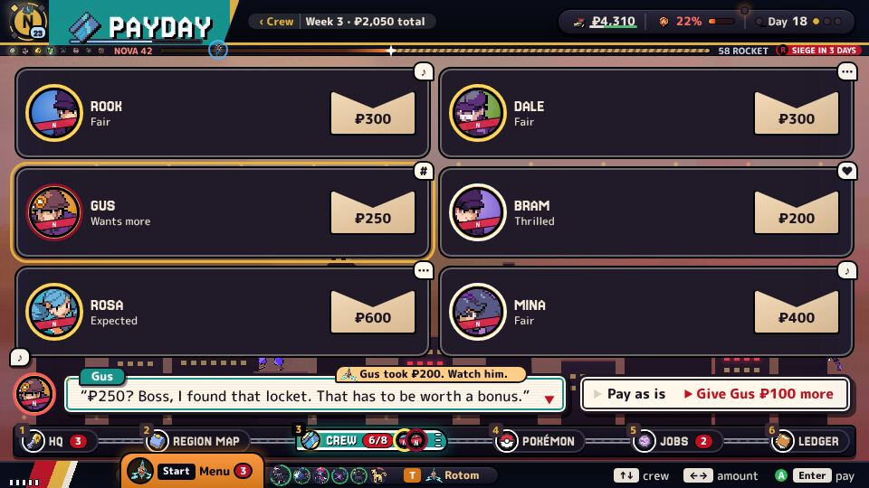 |  |
| Uniforms | 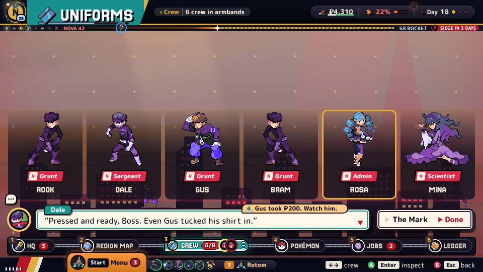 |  |
| Pyramid | 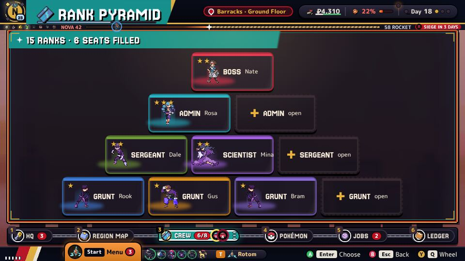 |  |
| Promotion | 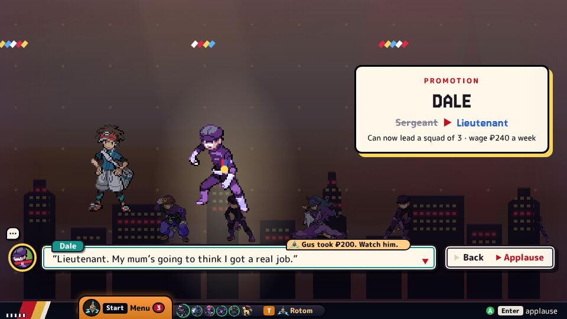 |  |
| Boss Edge | 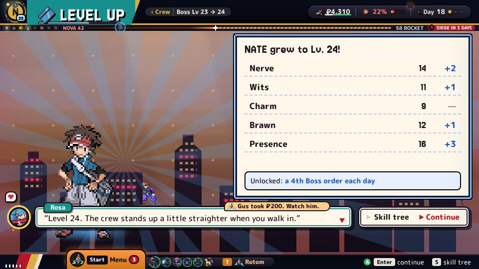 |  |
| Confront | 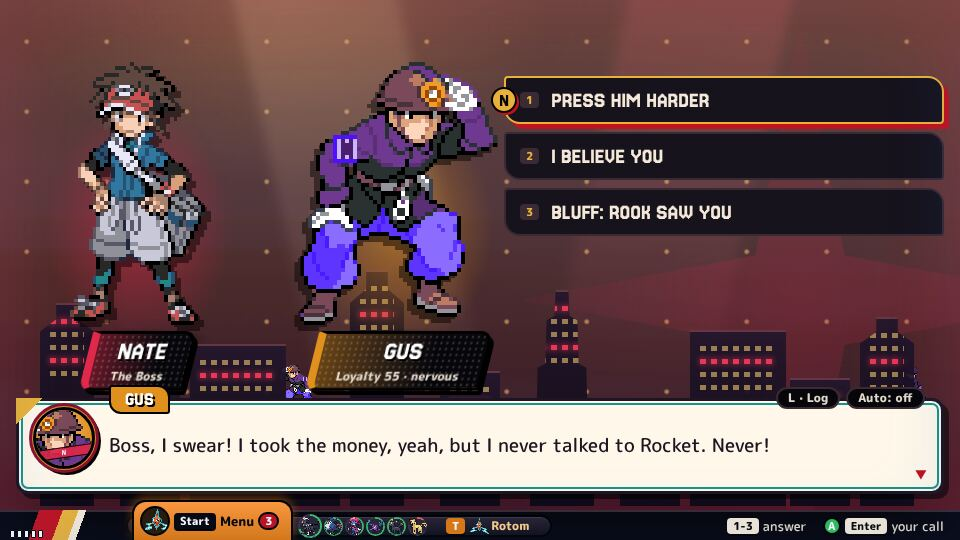 |  |
| Mole hunt | 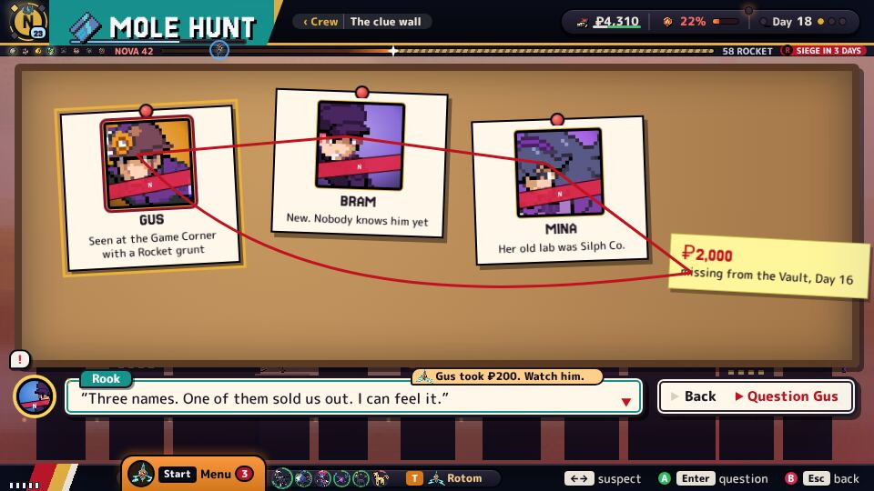 |  |
| Training | 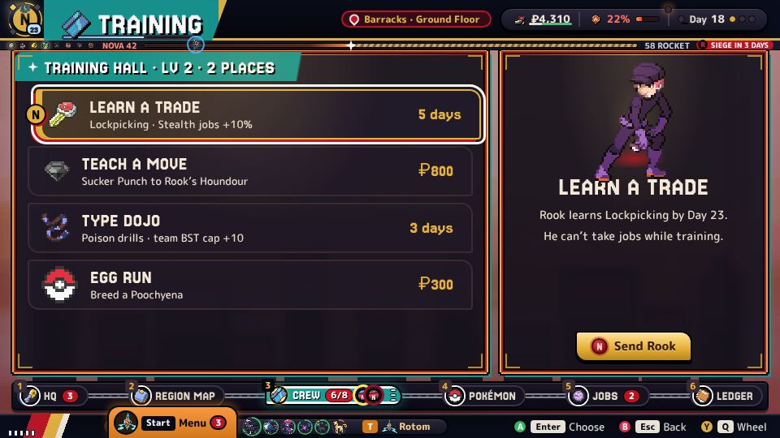 |  |
| New card | 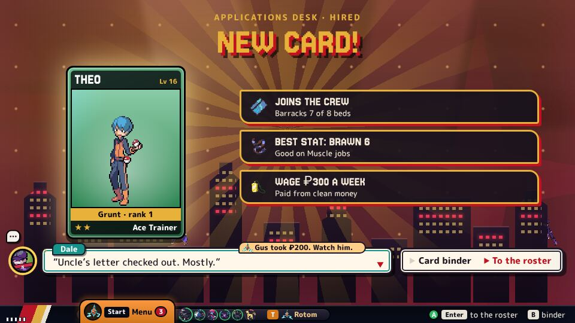 |  |
| People | 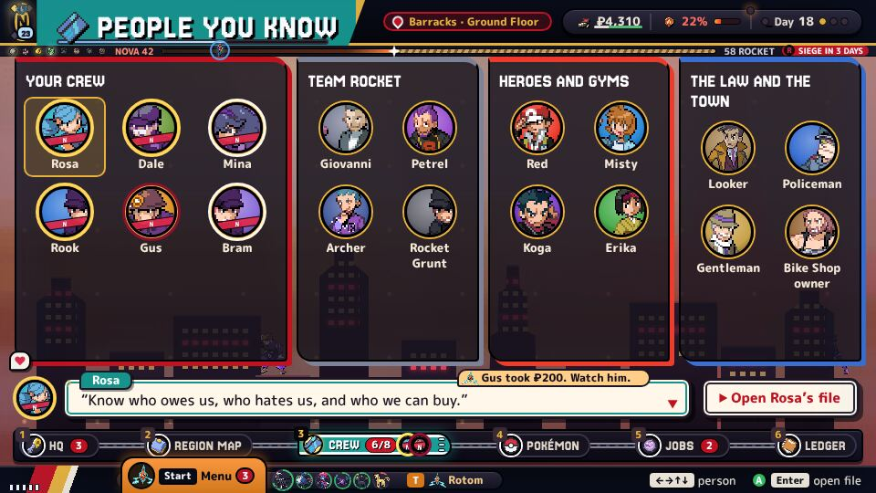 |  |
| Heart-to-heart | 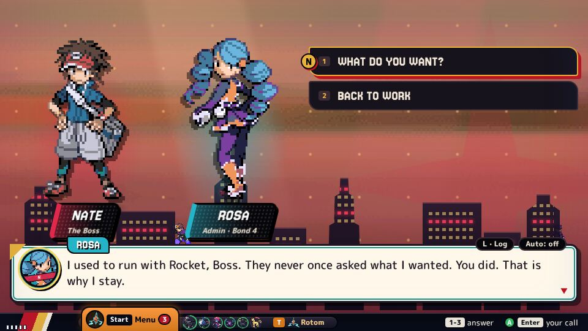 |  |
| Squads | 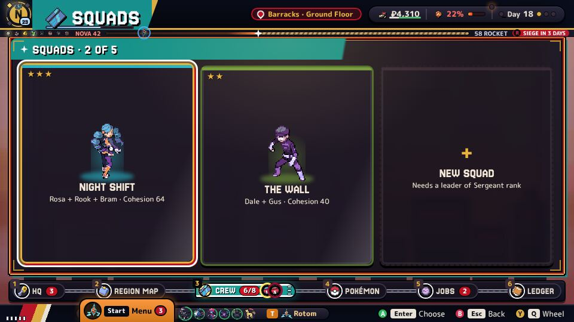 |  |

Differences left on purpose (live data, not looks): the run's own crew, ranks and numbers; the Pyramid shows one row per rank held (a small crew has short rows); the mole wall shows only members with Suspicion or a clue; People shows only the rival teams in play and the officers in the data.

## Needs a mechanic (not built, no placeholder)

- **binder** (card binder with Crew/Rocket/Heroes/Gyms/Town pages): no card-collecting mechanic.
- **bonds** (who likes whom): no member-to-member relationship values.
- **downtime** (one evening off at a place): no evening-off activity.
- **shelter** (storm night at the Compound): no storm event.
- **disguise** (dressing room outfits): no crew outfits.
- **skills** (Boss skill tree with points): no Boss skill points.
- **graffiti** (spray a team tag): no tag mechanic.
- Payday's "Give ₽100 more" bonus and the Boss level from the levelup mockup (the game has Edge stats instead).

## Known limits

- The squad builder and the order picker, the hire list and the leads list keep their older look over the new pages (no mockup for them).
- Training and People are reached by buttons on the roster (every free letter key on the Crew tab is taken).
- The Morning's talk card stays the old card on the HQ until the Day slice; on the Crew tab it is the heart-to-heart scene.

## Tests

- `tests/unit/dominionR5.test.ts`: the models leave the block unchanged; training/mole/pull/edge/people normal, empty and cap cases; pages keep their test ids and never name the helper anything but Rotom.
- `tests/e2e/dominionR5.spec.ts`: walks every built page with a six-member crew, promotes, hires, answers a talk, opens the mole wall and Confront; shots to the test output (`R5_WAIT=6000` waits out the first-entry banners for mockup comparisons).
- Updated for the roster-first Crew tab: `dominionBossMenu`, `dominionChair`, `dominionCrew`, `dominionReserve`, `dominionSquads`.
