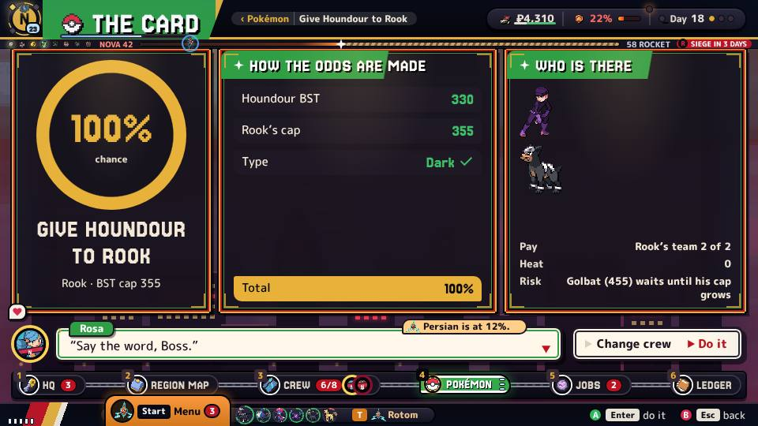
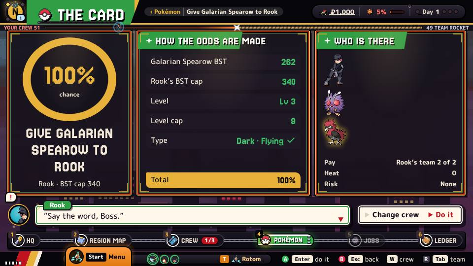
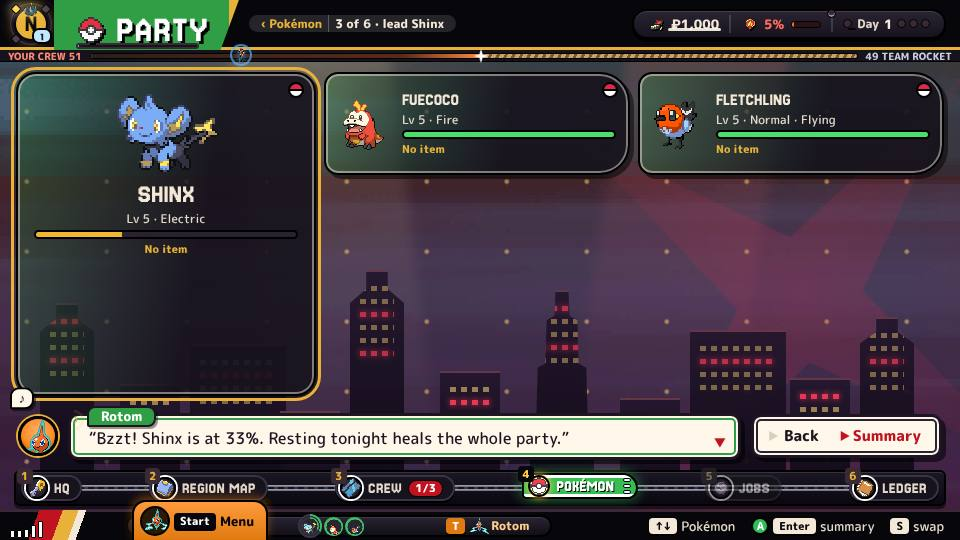
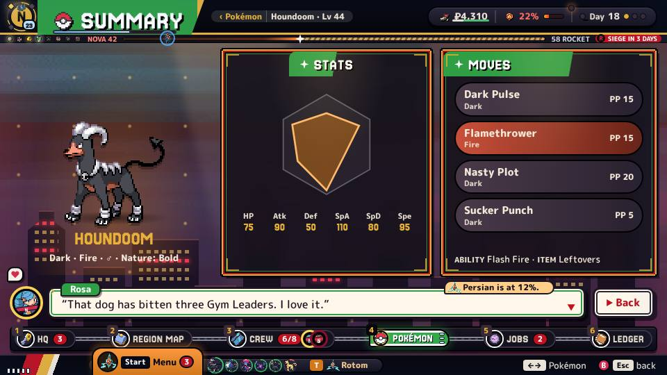
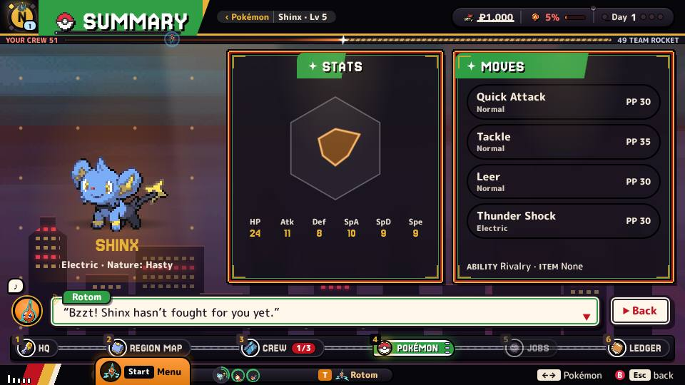
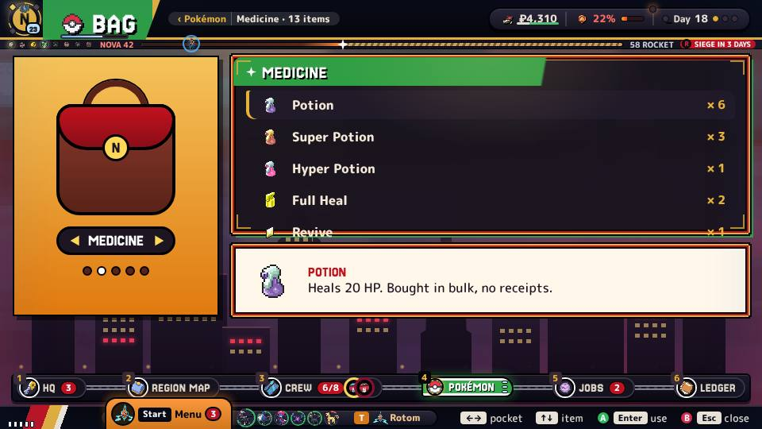
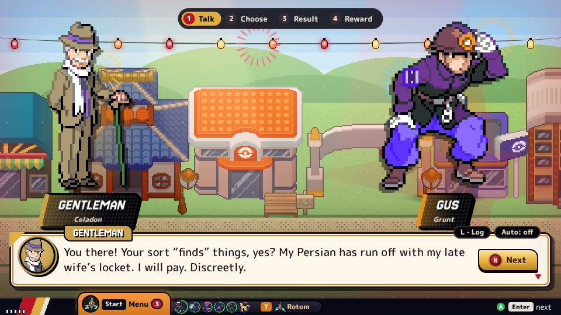
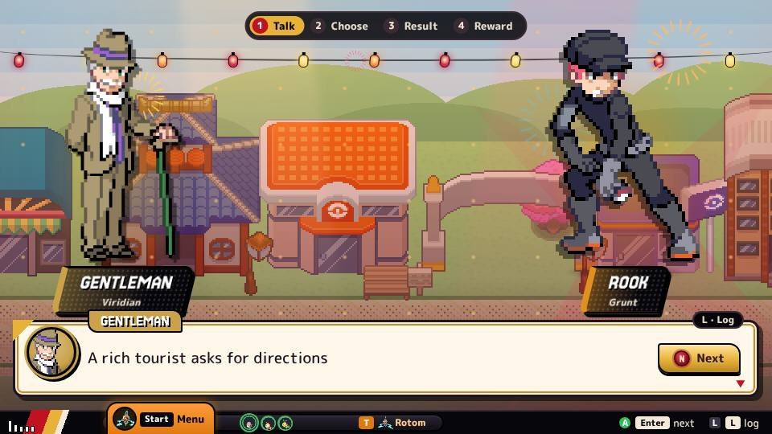
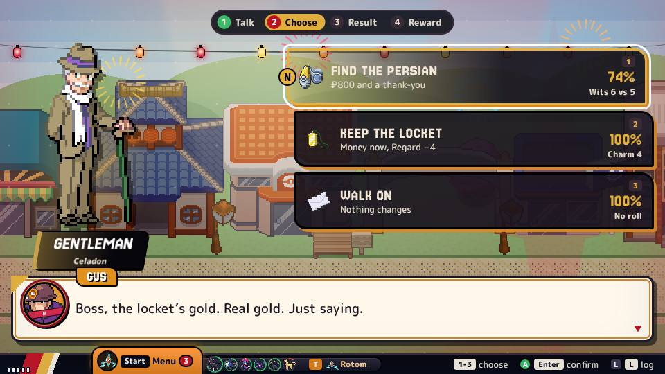
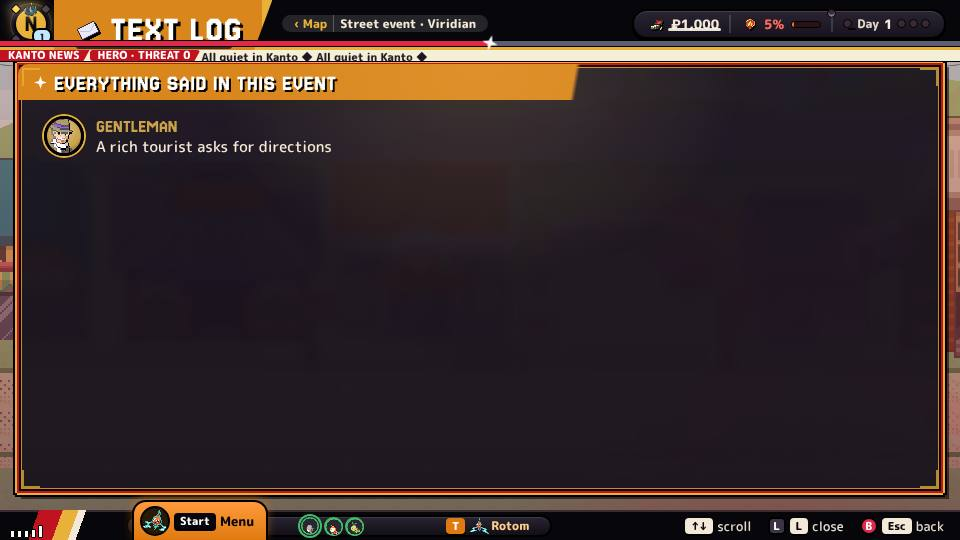

# Dominion redesign R6: Pokémon and events (pass 50)

Kice, 2026-11-21: "BUILD EVERYTHING AS CLOSE TO THE MOCKUPS AS YOU CAN." Slice R6 of `/mnt/project-files/plans/dominion-redesign-build/BUILD_SLICES.md`: the Pokémon group (reserve give party summary bag clinic care) and the Events group (event reward evchoose evresult log press festival prize blackout chapter). Built on R0's kit (`src/ui/redux/screens/dominion/r50/kit.ts`).

## What the player can do now

- **Reserve** (tab 4, mockup `reserve`): the box as a 6 x 2 grid of cards with stars (how strong the species is) and a tag only when it's out of the ordinary (ACE, OFF-TYPE, over a cap). F: fits only / all. A: auto-fill. [ ]: box pages (12 to a page now). X: set free. Enter opens the Card.
- **The Card** (mockup `give`): the odds ring (100% when the Pokémon fits, 0% when it doesn't), how the odds are made (BST against the member's BST cap, level against the level cap, type), who is there (the member, their team, the Pokémon), Pay / Heat / Risk. Change crew (W/E, ←→) switches who gets it (the Boss included). Tab picks a team slot, Enter takes it back. Do it gives.
- **Party** (mockup `party`, the party chip in the key strip): the Boss's six with HP bars, held items and Rotom's line about the most hurt one. S swaps two (GameSession.moveParty). Enter opens the Summary.
- **Summary** (mockup `summary`): the sprite, types and nature, the stat hexagon (base stats) with the Pokémon's own stats, the four moves with PP, ability and item. ←→ step through the party.
- **Bag** (mockup `bag`, new Start menu row): the pockets that have items, five rows around the cursor, the item's picture and text. Enter on a usable item picks a Pokémon on the Party page and uses it (GameSession.useItem).
- **A street meeting is an event** (mockups `event`, `evchoose`, `evresult`, `reward`, `log`): the town meetings (core/dominion/town.ts) now play in four beats instead of the map's side panel. Talk (who you met and where, the member on duty), Choose (each answer with its odds: the check's real chance and the member's stat, or 100% / no roll), Result (the roll: SUCCESS or MISSED, rolled N, needed M or less), Reward (only after the result's text is closed; it stays until a key). 1-3 answer straight away. L opens the Text log (everything said in this event).

## Rules kept

- Pages never change the run: the Card's odds, the Choose page's odds and every row are display only. Changes go through `GameSession.dominionStep` (give, takeBack, townMeet), `moveParty` and `useItem`.
- The answer's roll is the one `answerMeet` already made (same stream, same numbers): it is now returned with the answer (`MeetOut.roll`, `bits`) for the Result and Reward pages. No new RNG for meetings. (The last seven pages add the optional `life` block field and the `dominion-life` stream; no save bump.)
- Event text stays until a key press; the reward appears only after the text is closed.

## The last seven pages (director answer, 2026-11-21: build them with simple real rules)

The first PR listed clinic, care, press, festival, prize, blackout and chapter as "needs a mechanic". Kice's answer while away: build every page, with simple real rules taken from the mockups and the design docs. Rules in `src/core/dominion/life.ts`, numbers in `src/data/dominion/life.json` (Zod: `LifeFileSchema`). New block field `life` (optional, no save bump, like `tut` and `desk`). New RNG stream `dominion-life` only.

- **Clinic** (Party → H, or the Start menu): the back-alley Doctor heals for cash. ₽5 per missing HP %, rounded up to ₽5, +₽200 if fainted, +₽50 for a status. Heal them all (Enter) or just the one picked (J). The prices match the mockup (12% HP = ₽440).
- **Care time** (Party → C): once a day per Pokémon, Brush (+3 friendship), Poké Puff (+10, ₽100) or Play (+5). It raises the game's own friendship, which already drives hearts, loafing, Return and friendship evolutions; the panel shows hearts, mood, last fed, the bonus that applies now, and the favourite flavour from the nature.
- **Press**: street meetings with the media (outside.json section J: reporter, camera crew, radio) are asked on camera on the press page, answers on the right (1-3). Same rules as any street meeting.
- **Region Events** (01_START_AND_THE_DAY.md §2.2, "every 28 days ... opens one special action for a few days"): from Day 14, every 28 days, for 3 days, alternating **Fireworks Night** and the **Blackout** in Celadon (or the region's first town). The page opens on its own on the morning it starts (once; the festival lantern on the top bar opens it again). One special action per event: a festival job (Pickpocket, Rob the stall, Swap the prize Porygon) or a blackout target (dark buildings +25% odds). Each is a check like a street meeting (30% + 8% x the best member's stat), with its odds on the page; money or a Pokémon on a pass, Heat either way. Just watch / Stay in lets it pass.
- **Prize Corner** (Start menu, or P on the festival): 50 coins for ₽1,000 (B); trade coins for Porygon, Dratini, a Rare Candy or an Amulet Coin (Enter); or Swap it, a Stealth check at −20% once a day (a miss is Heat +10).
- **Chapter card**: the run's chapter follows what it did: 1 Humble Beginnings (the opening), 2 A Name on the Door (founded), 3 Making Noise (Notoriety step 3), 4 The Siege (step 5). A new chapter's card shows on the next new day, until Enter.

## Mockup vs game (960x540)

| Page | Mockup | Game |
|---|---|---|
| Reserve |  |  |
| The Card |  |  |
| Party |  |  |
| Summary |  |  |
| Bag |  |  |
| Talk |  |  |
| Choose |  |  |
| Result |  |  |
| Reward |  |  |
| Text log |  |  |
| Clinic |  |  |
| Care time |  |  |
| Press |  |  |
| Fireworks Night |  |  |
| Prize Corner |  |  |
| Blackout |  |  |
| Chapter card |  |  |

Differences left on purpose (live data, not looks): a new run's box, party and bag are small; the person you meet is drawn from their job (Gentleman, Jenny, Scientist and so on); the Result page has no prize picture (meetings don't name one); the Choose page's crew line is "Your call, Boss." (meetings have no crew lines yet); there's no "Auto" text chip on most event pages (no auto-advance in Dominion). The Blackout's clock counts days, not minutes (Dominion has no real-time clock, 01 §2.3). The chapter shown is Chapter 2 (the test's run); the mockup shows Chapter 4.

## Tests

- `tests/unit/dominionR6.test.ts` (8): the Choose odds equal the roll's chance; the answer's roll and bits are the same for the same seed; a sure answer has no roll and its reward is in the bits; a gone meeting / wrong index changes nothing; event pages (reward only on its own page, log window); the Reserve keeps its test ids and changes nothing; the Card's 100% / 0%; Party, Summary and Bag rows.
- `tests/e2e/dominionR6.spec.ts` (2): Reserve, Card (Change crew, Esc without giving, give), Party, Summary, Bag (Potion used on the lead), three window sizes; a meeting through Talk, Choose, the log, Result and Reward, and a second one answered with key 1. No console errors.
- `tests/unit/dominionLife.test.ts` (7): Clinic prices, healing and refusals; Care once a day, Puff costs and counts as fed, fainted waits; Region Events' days, kinds, same roll for the same seed, one action per event, letting it pass; the Blackout's dark bonus; coins, trades and one swap a day; chapters.
- `tests/e2e/dominionLife.spec.ts` (1): Clinic (heal), Care (Puff, once a day), the press (answer with 1), Fireworks Night (a job rolled), the Prize Corner (coins, too dear), the Blackout (Esc, the lantern, Stay in), the Chapter 2 card. No console errors.
- Updated for the new flow: `tests/e2e/dominionReserve.spec.ts` (Enter opens the Card first), `tests/e2e/dominionTown.spec.ts` (the meeting is an event).
