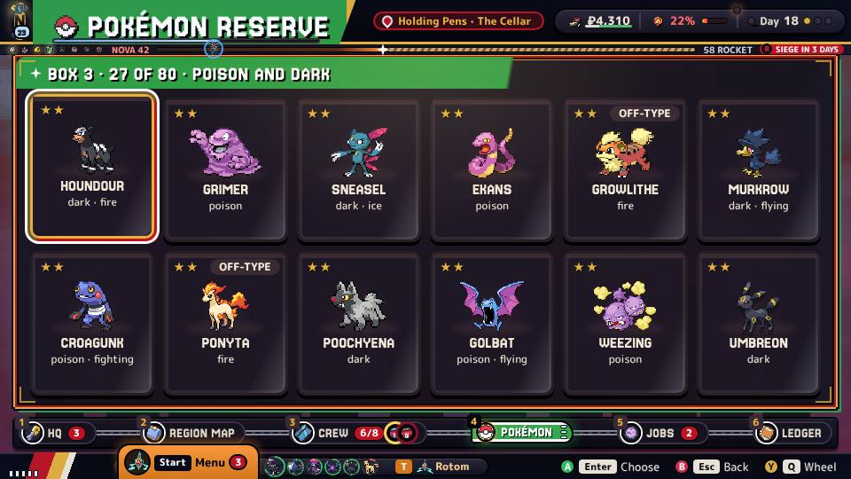
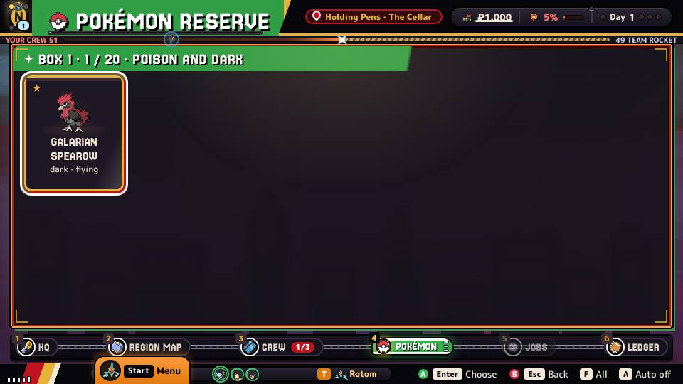
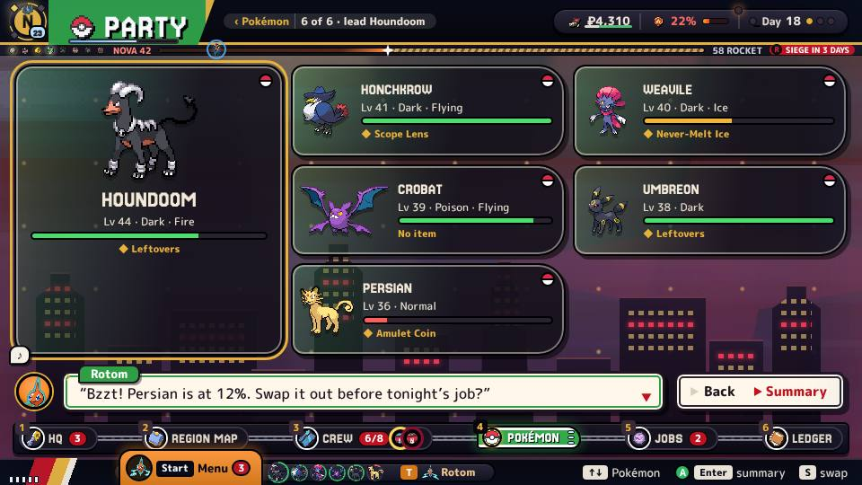
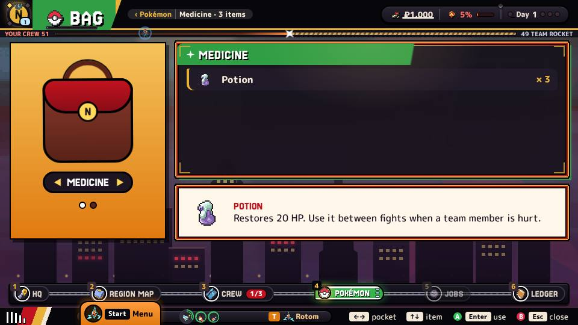
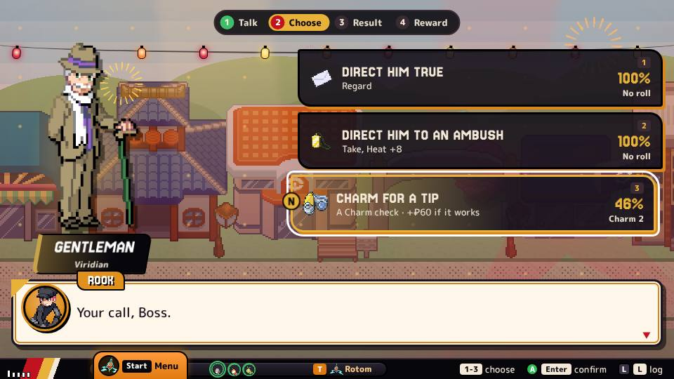
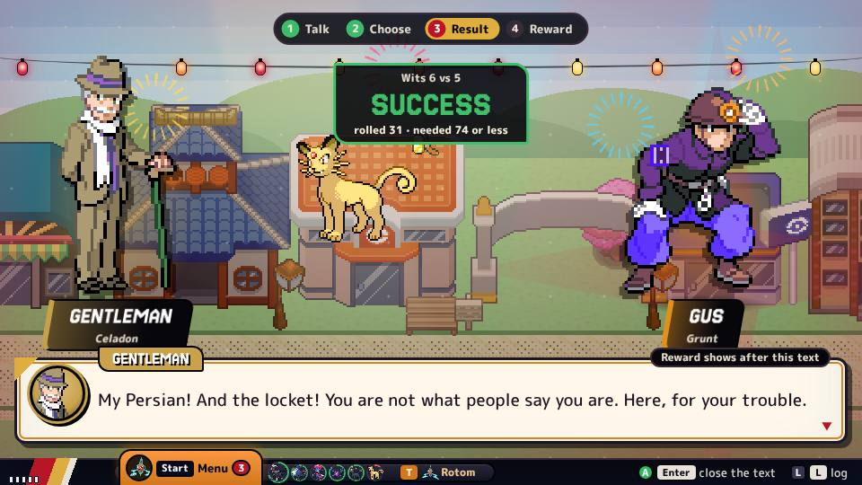
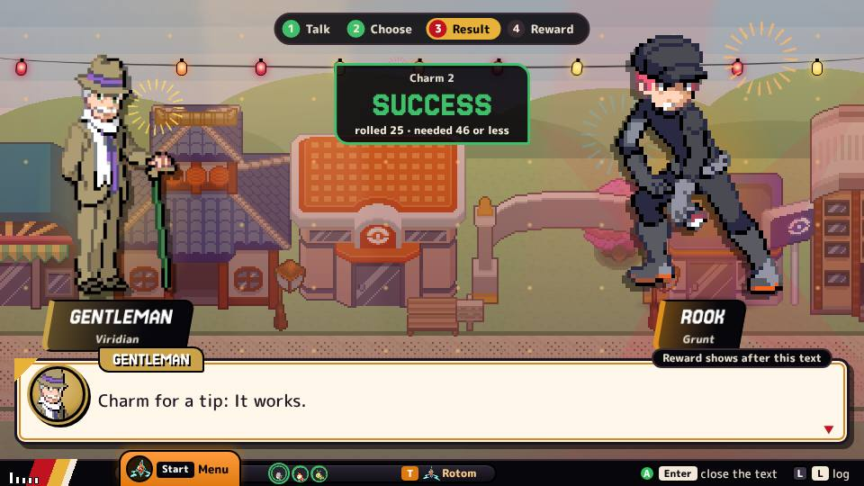
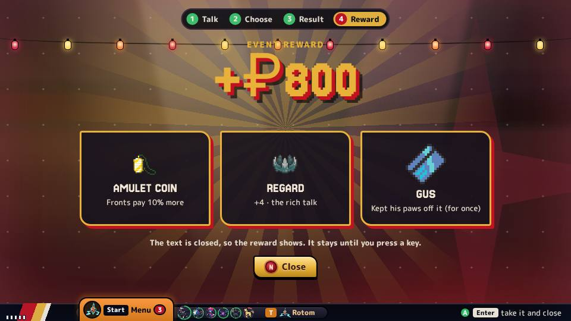
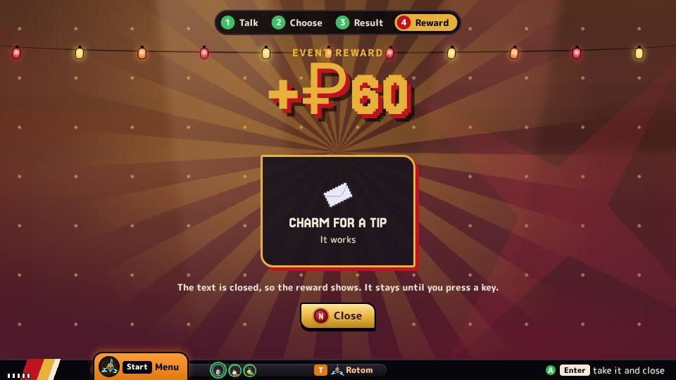
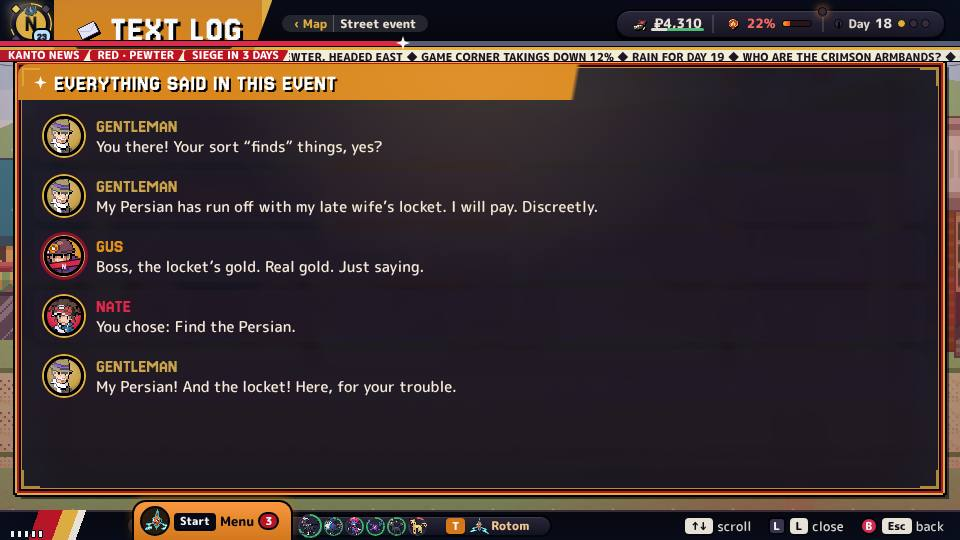

# Dominion redesign R6: Pokémon and events (pass 50)

Kice, 2026-11-21: "BUILD EVERYTHING AS CLOSE TO THE MOCKUPS AS YOU CAN." Slice R6 of `/mnt/project-files/plans/dominion-redesign-build/BUILD_SLICES.md`: the Pokémon group (reserve give party summary bag clinic care) and the Events group (event reward evchoose evresult log press festival prize blackout chapter). Built on R0's kit (`src/ui/redux/screens/dominion/r50/kit.ts`).

## What the player can do now

- **Reserve** (tab 4, mockup `reserve`): the box as a 6 x 2 grid of cards with stars (how strong the species is) and a tag only when it's out of the ordinary (ACE, OFF-TYPE, over a cap). F: fits only / all. A: auto-fill. [ ]: box pages (12 to a page now). X: set free. Enter opens the Card.
- **The Card** (mockup `give`): the odds ring (100% when the Pokémon fits, 0% when it doesn't), how the odds are made (BST against the member's BST cap, level against the level cap, type), who is there (the member, their team, the Pokémon), Pay / Heat / Risk. Change crew (W/E, ←→) switches who gets it (the Boss included). Tab picks a team slot, Enter takes it back. Do it gives.
- **Party** (mockup `party`, the party chip in the key strip): the Boss's six with HP bars, held items and Rotom's line about the most hurt one. S swaps two (GameSession.moveParty). Enter opens the Summary.
- **Summary** (mockup `summary`): the sprite, types and nature, the stat hexagon (base stats) with the Pokémon's own stats, the four moves with PP, ability and item. ←→ step through the party.
- **Bag** (mockup `bag`, new Start menu row): the pockets that have items, five rows around the cursor, the item's picture and text. Enter on a usable item picks a Pokémon on the Party page and uses it (GameSession.useItem).
- **A street meeting is an event** (mockups `event`, `evchoose`, `evresult`, `reward`, `log`): the town meetings (core/dominion/town.ts) now play in four beats instead of the map's side panel. Talk (who you met and where, the member on duty), Choose (each answer with its odds: the check's real chance and the member's stat, or 100% / no roll), Result (the roll: SUCCESS or MISSED, rolled N, needed M or less), Reward (only after the result's text is closed; it stays until a key). 1-3 answer straight away. L opens the Text log (everything said in this event).

## Rules kept

- Pages never change the run: the Card's odds, the Choose page's odds and every row are display only. Changes go through `GameSession.dominionStep` (give, takeBack, townMeet), `moveParty` and `useItem`.
- The answer's roll is the one `answerMeet` already made (same stream, same numbers): it is now returned with the answer (`MeetOut.roll`, `bits`) for the Result and Reward pages. No new RNG, no new save field, no save bump.
- Event text stays until a key press; the reward appears only after the text is closed.

## Needs a mechanic (not built, no placeholder)

| Page | Why |
|---|---|
| `clinic` | No paid healing exists. Pokémon heal for free on a rested night (Part 1 §2.1); a back-alley clinic is in no design doc. |
| `care` | No affection, Poké Puffs or brushing in the game or the Evil Mode docs. |
| `press` | No reporter interviews. The nearest are the Chair's court answers (R8) and Debates. |
| `festival`, `prize` | Festivals are a monthly **Region Event** in `plans/evil-mode-rework/01_START_AND_THE_DAY.md` (line 63), which isn't built yet; there are no Game Corner coins. Building Region Events (a schedule, a block field, one special action for a few days) is its own slice with a save bump. |
| `blackout` | The Blackout action exists (growth.json: cut a district's power, Heat −6), but the page's "pick a building in 40 minutes" has no mechanic. Also listed under Region Events. |
| `chapter` | The Dominion has no chapters. |

## Mockup vs game (960x540)

| Page | Mockup | Game |
|---|---|---|
| Reserve |  |  |
| The Card |  |  |
| Party |  |  |
| Summary |  |  |
| Bag |  |  |
| Talk |  |  |
| Choose |  |  |
| Result |  |  |
| Reward |  |  |
| Text log |  |  |

Differences left on purpose (live data, not looks): a new run's box, party and bag are small; the person you meet is drawn from their job (Gentleman, Jenny, Scientist and so on); the Result page has no prize picture (meetings don't name one); the Choose page's crew line is "Your call, Boss." (meetings have no crew lines yet); there's no "Auto" text chip (no auto-advance in Dominion).

## Tests

- `tests/unit/dominionR6.test.ts` (8): the Choose odds equal the roll's chance; the answer's roll and bits are the same for the same seed; a sure answer has no roll and its reward is in the bits; a gone meeting / wrong index changes nothing; event pages (reward only on its own page, log window); the Reserve keeps its test ids and changes nothing; the Card's 100% / 0%; Party, Summary and Bag rows.
- `tests/e2e/dominionR6.spec.ts` (2): Reserve, Card (Change crew, Esc without giving, give), Party, Summary, Bag (Potion used on the lead), three window sizes; a meeting through Talk, Choose, the log, Result and Reward, and a second one answered with key 1. No console errors.
- Updated for the new flow: `tests/e2e/dominionReserve.spec.ts` (Enter opens the Card first), `tests/e2e/dominionTown.spec.ts` (the meeting is an event).
