# Dominion redesign R9 follow-up: the Rotom Phone's pages and the left-out settings rows

Director answer while Kice was away (2026-11-26): "Kice wants everything built, so add simple real features behind the 13 missing pages and the left-out rows." Specs come from the pass-50 mockups (`plans/evil-mode-rework/redesign-50/src/p13, p20, p27, p30, p35, p40, p46, p49, data.js`). Built on R9 (`docs/status/dominion-r9.md`) and the evil-mode repair (#1569).

## What the player can do now

- **Ask Rotom** (`ask`): T on the HQ, or the Rotom chip in the key strip. Five questions about this run (tonight's best job, who is unhappy, where the Hero is, how to beat the next Gym, what to buy), answered from the save. Links to Rotom's plan and Rotom's diary.
- **Rotom's plan** (`rplan`): three plans for tonight (a quiet job, a big night, lie low), each with its chance and money from the Job board; Rotom picks one and says why (lie low when Heat is 60% or more, or there's no job). Enter twice goes to the Job board.
- **Rotom's diary** (`rdiary`): four lines a day (morning, noon, evening, night) drawn from the run. The same day always reads the same; ← → turns the days.
- **Crew banter** (`chatter`): a talk scene with Rotom and one of the crew. Setting **Crew banter** (Off, Some, Lots) in Settings › Rotom: Some every eighth page change, Lots every fourth. When it's due the Rotom chip types (a bubble); T opens it. It never opens by itself.
- **Inbox** (`inbox`) and **Messages** (`msgs`): what's waiting (the desk, the Hero, a rival at boiling point, a job, the paper), plus a chat with each of the crew. Replies open the page they're about.
- **Radio** (`radio`): four stations from the week's news; the police band; the pirate station waits for a Radio Room.
- **Adventure log** (`journal`), **The road so far** (`chapters`): the days so far, and five chapters (done, now, next, locked) from the run's progress.
- **Jukebox** (`jukebox`): every song heard in the game is added (saved in settings); Enter plays a heard one. Unheard songs show "???".
- **Photo mode** (`photo`): pose, frame, filter, stickers and who is in it (the Boss and the crew). P saves a picture (PNG) to your device; the album counts them.
- **On a phone** (`portrait`): switch the tall-screen layout on or off (tabs at the bottom, panels as sheets).
- **Captions** (new Settings tab after Sound): Captions, Caption size (S, M, L), Music names. With captions on, sounds show their words over the page and new songs show their name.
- **Left-out rows, now real:** Sound › Voices volume and Mute when away; Screen › Focus view and On a phone; Colour assist › Palette (red-green safe); Read aloud › Voice (the browser's voices) and Voices volume; Button feel › Button sounds and Menus wrap round; Region skin › Locked skins (show or hide). Settings › Rotom also lists every phone app.

Every page reads the run and never changes it; only the settings record is written (heard songs, photo count, the look).

## Still left out (and why)

- Auto-Checker: HQ floors aren't in this release. Stage length: Dominion has no nodes. Spend cap: Kice fixed it at $10. Sound arrows and Voice blips: the game has no positional sound or per-letter blips yet.

## Save change

Settings **v49**: the phone's look settings (`chatter`, `captions`, `capSize`, `musicNames`, `heard`, `photos`, `voice`, `voiceVol`, `awayMute`, `focus`, `palette`, `wrap`, `clicks`, `lockedSkins`, `tall`). v48 to v49 fills them with their defaults and keeps everything else. Next free settings version: 50.

## Tests

- Unit: `tests/unit/dominionR9b.test.ts` (models leave the block as it was, same day reads the same, day clamps, radio lock, plan picks lie low at high Heat, crew chats on a new run, every page keeps its test ids and never says Claude or AI, v49 migration, round trip, a bad value refused).
- Browser: `tests/e2e/dominionR9b.spec.ts` (all twelve pages, T, Esc back, photo download, the tall switch, crew banter, Captions and a click's caption, run unchanged). `dominionR9`, `dominionNav` and `dominionBossMenu` updated for the Captions tab.

## Mockup vs game (960x540; game on top, mockup under)

| | | |
|---|---|---|
| Ask Rotom 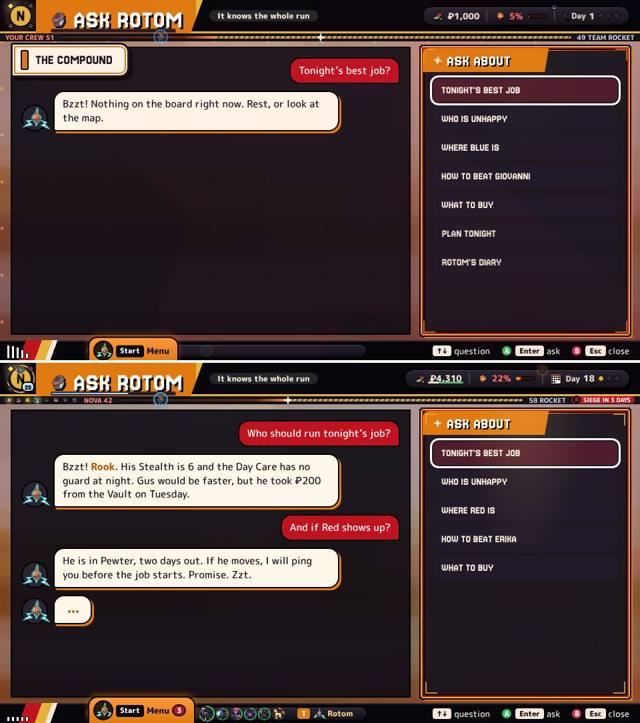 | Rotom's plan 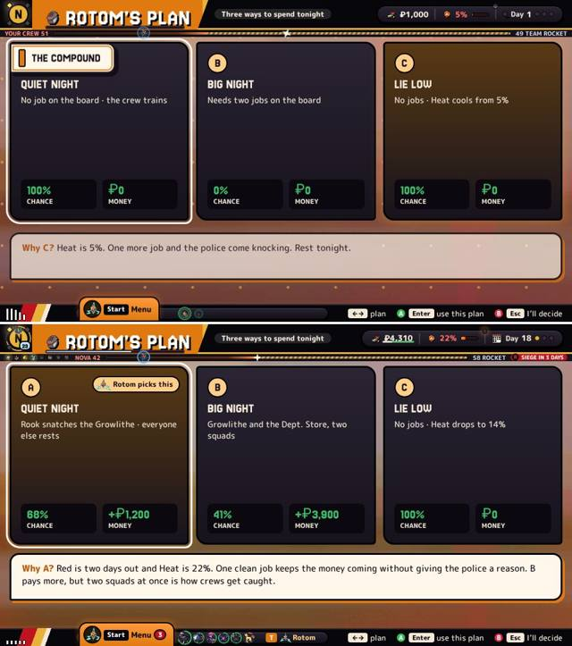 | Rotom's diary 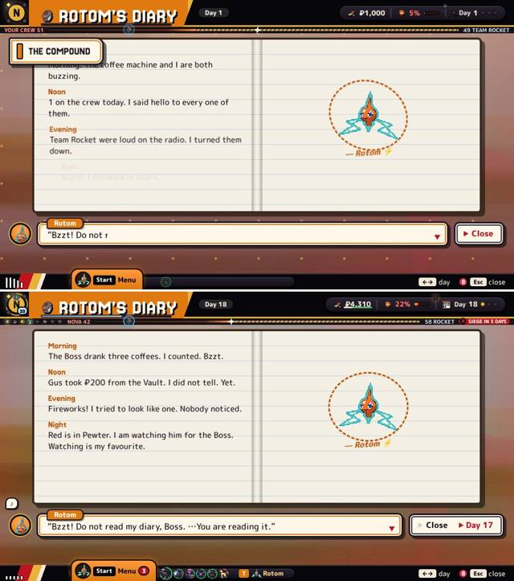 |
| Crew banter 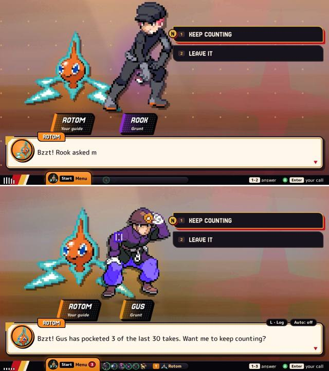 | Inbox 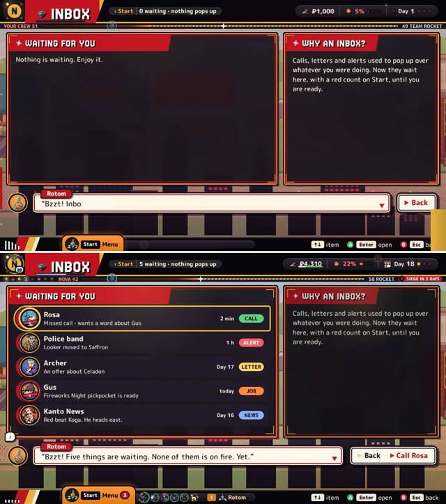 | Messages 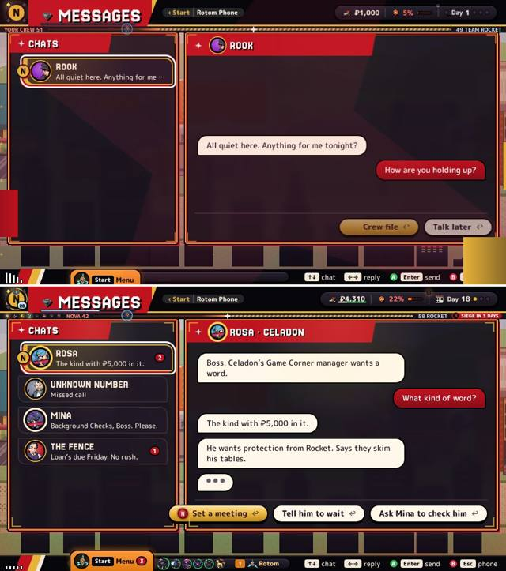 |
| Radio 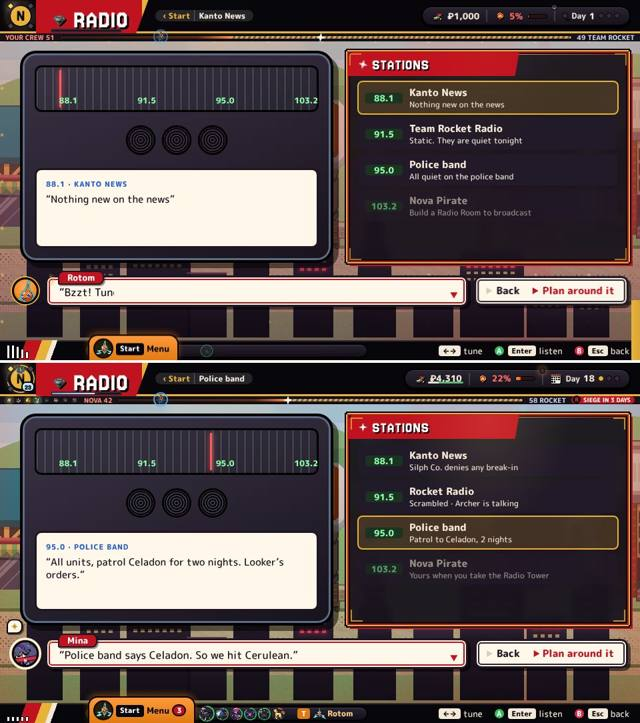 | Adventure log 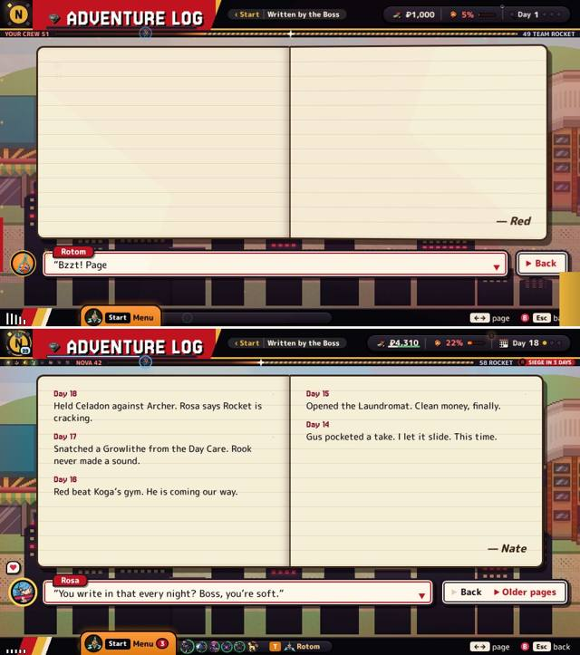 | The road so far 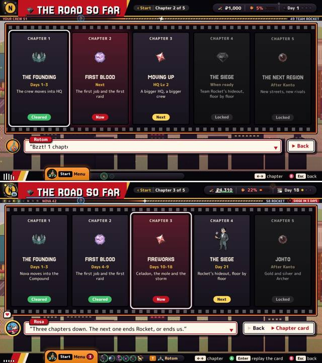 |
| Jukebox 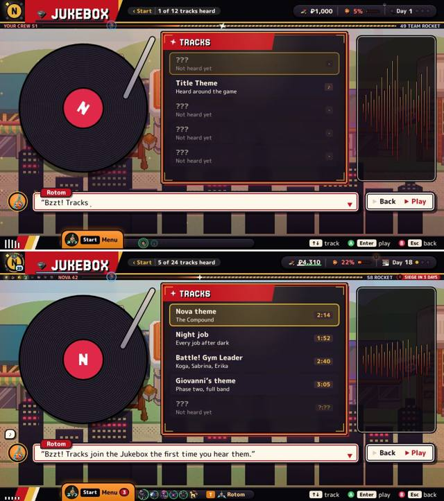 | Photo mode 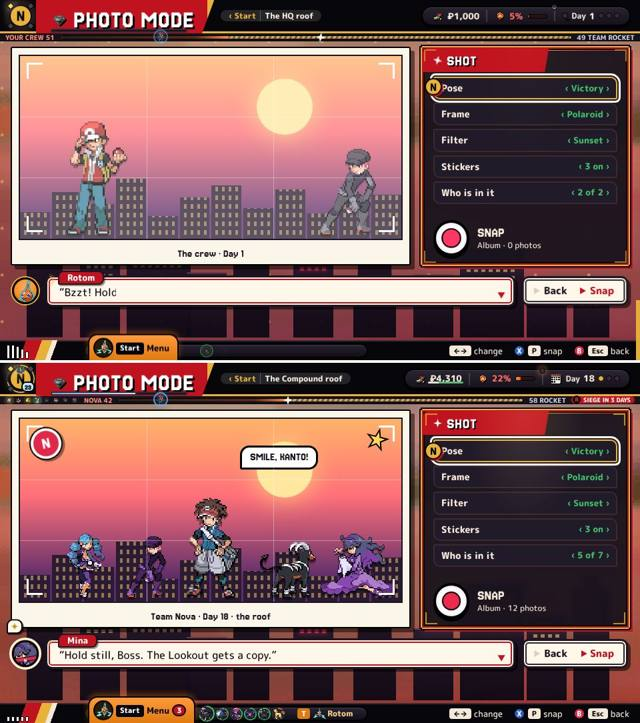 | On a phone 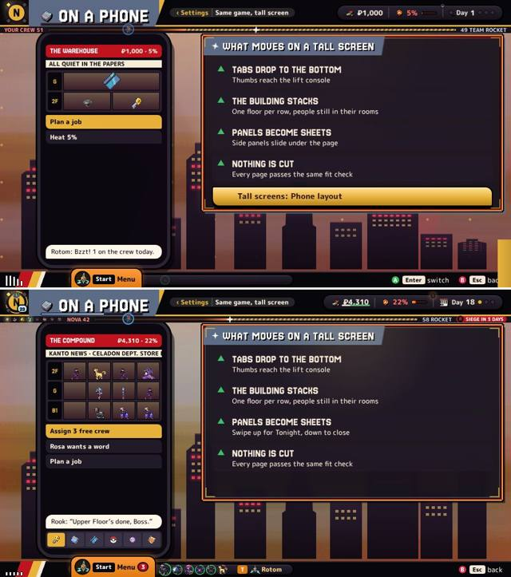 |
| Captions 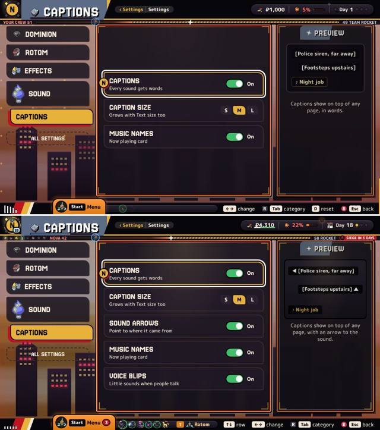 | | |

Differences on purpose: the game shows a new run on day 1 (one crew member, an empty inbox, the log's first page), so lists are shorter than the mockups' day 18. Text that types in or fades in (the log, the diary's night line) is caught mid-animation in a 600 ms shot.
